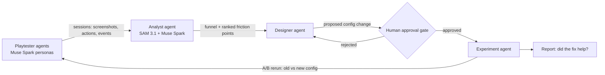

# Meta Game Onboarding Optimizer

**A closed-loop, multi-agent system that playtests a game's onboarding, finds where new players get stuck, proposes fixes, and verifies them with A/B reruns, with a human approving every change.**

Built for the [Meta Global AI Developer Hackathon](https://cerebralvalley.ai/e/meta-ai-developer-hackathon) (Oct 26 – Nov 4, 2026) · Problem statement: **Build for Your World**

## About the event

This project was built for the **Meta Global AI Developer Hackathon**, run by Meta with Cerebral Valley from **October 26 to November 4, 2026**. About ten days, one constraint: build something real with Meta's model family (Muse Spark, Muse Wonder, Muse Image, SAM 3.1) inside the event window. We entered the **indie developer track** under the theme **Build for Your World**: bring Meta's models into a domain you know firsthand. Ours is game development, where the first minutes of a game decide whether a player stays and playtesting those minutes is slow and expensive. Winners are announced at the closing ceremony on November 9, 2026.

The game under test is **Hearths of the Glen**, our own Celtic dawn-age village builder (three eras, heroes, a campaign arena), built alongside the agents so every fix can be played, not just described.

> All code in this repository was written during the event (Oct 26 to Nov 4, 2026).

## Why

The first minutes decide whether a player stays. Game teams find onboarding friction through playtests and funnel analysis, which is slow and expensive, and every fix needs another round of testing. This project closes that loop with agents: play → diagnose → fix → approve → verify.

## How it works



1. **Playtester agents (5 literature-grounded personas).** Muse Spark computer-use agents with working-memory scratchpads and distinct player-type psychology (`Rush-Clicker` / BrainHex Daredevil, `Story-Guided` / Quantic Story, `Strategist` / Bartle Achiever, `Tinkerer` / Bartle Explorer, `Hoarder` / Quantic Completion) play the browser game by looking at the screen and clicking.
2. **Analyst agent.** It uses SAM 3.1 to segment UI elements in gameplay screenshots and Muse Spark to reason over sessions. It builds an onboarding funnel and ranks friction points with quantified evidence, including the SAM 3.1 distractor-to-goal visual salience ratio (`6.76x` on the baseline stall).
3. **Designer agent & Feature Forge.** It proposes concrete onboarding config fixes (`patch_001`) or turns a Game PM's free-text feature idea into a schema-validated `FeaturePlugin` patch with a generated UI emblem (`Muse Image` / procedural stub), plus archetype-aware reworks when a naive feature hurts onboarding.
4. **Human approval gate.** No config or feature patch is applied or playtested until a human approves it (`403` until approved).
5. **Experiment agent.** It reruns the playtesters on the baseline and patched configs as a paired A/B comparison (McNemar exact test + paired bootstrap CI) and renders a 1-page Council Report (`❌ HURTS`, `⚠️ MIXED`, `✅ POSITIVE`) with side-by-side replay.
6. **Validation.** Agent findings are compared against real human play sessions.

## Meta models used

Every agent in the loop runs on a Meta model. The game itself was also built with one.

| Model | ID in code | Where it works | What it does |
|---|---|---|---|
| Muse Wonder | `muse-wonder-1.0` | Development; Designer agent; optional bot brain | Wrote the game and backend as the coding agent. In the game, it drafts feature ideas, reworks, and patch proposals behind `Ask Muse Wonder`. The Bug hunting and A/B menus can also pick it as the bot's brain. |
| Muse Spark | `muse-spark-1.3-contributor` | Playtester bots; Analyst agent; report summaries | Default brain of the vision playtesters: it sees the marked screenshot and picks each click. It also writes the diagnosis and proposed fixes in every bug hunt report, and the plain-language summary at the top of each A/B report. |
| SAM 3.1 | `sam-3.1` | Playtester bots; Analyst agent | Segments each screenshot and marks the real UI targets, so bot clicks land on rendered elements. The analyst reuses the masks for its visual salience note in the report. |
| Muse Image | Muse Image | Game art; Feature Forge | Painted the valley backdrop, building and villager sprites, Viking heroes, the ten Celtic Otherworld guardians, attack poses, and the eight arena backgrounds. It also generates each new feature's emblem. |
| Muse Voice Transcribe | `muse-voice-transcribe-1.0` | Playtester bots (optional) | Bot ears, off by default in the menus. It transcribes each Elder voice line once, caches the transcript, and the bot hears the line as speech, never as the written script. |

Model choice is part of the test design, so runs record which model played. A cheaper Spark run and a stronger Wonder run never share a verdict. All paid calls pass through one budget ledger with a hard cap, in `configs/budget_config.json` and `runs/cost_ledger.jsonl`.

## Status

- [x] Browser game with config-driven onboarding and event logging (2.5D isometric, Dawn Age to Stone Age)
- [x] Config, patch and human approval gate backend (FastAPI, Pydantic)
- [x] Unbiased telemetry: raw events, server-derived `stuck` events and run summaries
- [x] Playtest Menu on the main screen: bug hunting, A/B tests and saved reports, plus the Studio panel with live bot view, patch approval and the full-screen report
- [x] Side-by-side replay of two recorded runs
- [x] Stub persona bot behind Watch Bot Play (offline placeholder, labelled STUB)
- [x] Three eras (Dawn, Stone, Bronze Age), upgrades, quests, expeditions and worker assignment
- [x] Async Playwright bot runner with Set-of-Mark frames, cost ledger, budget caps and response cache
- [x] Playtester agents with Muse Spark (computer use): live hunts and A/B pairs played from the Playtest Menu, working-memory scratchpad per persona, every run saved with frames, thoughts and telemetry
- [x] Analyst agent: stuck step, stuck frame, SAM 3.1 distractor-to-goal visual salience ratio (6.76x on the demo run) and think-aloud quotes, all surfaced in the Council Report; live SAM 3.1 plus Muse Spark diagnosis on Meta hunts
- [x] Designer agent staging a validated patch behind the approval gate
- [x] Experiment agent: canary, worker pool, paired A/B reruns, McNemar and bootstrap report
- [x] Closed loop from the CLI in stub mode (`python -m backend.cli run-closed-loop`)
- [x] Committed demo runs in `runs_demo/` and a Dockerfile for a single-port deploy
- [x] Feature studio in the Playtest Menu: free-text feature to a validated patch with a Muse Image emblem, five research-grounded personas, playtest behind the approval gate, verdict report and archetype-aware rework synthesis. Pre-baked HURTS → POSITIVE demo bundle (`patch_005`/`patch_006` + 20 committed runs) with a 1-click Council Report switcher and split replays
- [x] Full "Hearths of the Glen" 2.5D overhaul: sunlit Alpine Valley backdrop, Checkered 4x4 Territory Expansions (exp_1/exp_2), Sacred Obelisk +20% Culture Adjacency Aura, FREE instant-finish chips, Hero Roster & Level-Up Hall (Bera the Shield-Hunter & Sunweaver Lyra Lv.1–7), 8-Stage Ancient Wilds Campaign with Stage 6 Sabertooth Defeat Wall, Live 2.5D Tactical Combat Arena with Ultimate Portrait Cut-Ins, 6-Chapter Quest Ledger, and continuous Valley/Battle soundtrack + physical-modeling SFX
- [x] Gameplay-fix batch: 8-tech tree (Sturdy Construction gates Lv.2, Stone Age Awakening gates Lv.3, Bronze Age Dawn needs every earlier Dawn/Stone research plus the 20-minute `bronze_unlock_min_sim_sec` timer, Irrigation last as a Bronze Age tech; Tech Tree window draggable by its header), free placement on any open meadow tile with a soft meadow glow (forest corner and cliffs blocked, no numbered plot boxes), separate Upgrades menu with the on-building chip only when usable and no permanent Lv badge, worker sign only on unstaffed producers (tap assigns; producers built with no free worker start unstaffed), production cycles 12s food / 20s wood / 15s stone / 20s smelter, Heroes' Arena (needs Barracks) with timed hero training (`hero_training_sec`, never instant), renamed heroes Bera the Shield-Hunter, Sunweaver Lyra, Ember-Keeper Ignis and Tor the Stone-Breaker (ids unchanged, new stone-age bust portraits), campaign stages as medallion nodes on a dotted trail over the campaign map backdrop, and Elder Kaelen advisor speech pre-rendered with ElevenLabs (silent in battle; in bot runs the watch screen relays it quietly)
- [x] Playtest Menu: 3 prebuilt feature presets (`configs/feature_presets.json`), "Approve & play" approval, custom idea box, and full-screen report
- [x] Handover regression fixed: stub bot saves for Masonry in free play, so variant B reaches the Stone Age on seeds 42 and 44 again (full suite: 99 passed)
- [x] Sound and voice (ElevenLabs, not a Meta model): Celtic soundtrack, Elder Kaelen voice lines, bot persona voices and sound effects, generated once and shipped as audio files (`scripts/generate_kaelen_voice.py`, `scripts/generate_sfx.py`)
- [x] Validation against human sessions
- [x] Demo video (3 minutes, linked in the hackathon submission)

The onboarding friction in the base config is planted on purpose, so the loop has a known problem to find. At `onb_03_handoff` the Woodcutter Hut is unlocked and marked NEW!, while the Research button is small. A player who builds the hut drops below the 30 wood that Basic Toolmaking needs, and the hut produces nothing without that tech. `configs/patches/patch_001.json` is the baseline onboarding fix behind the approval gate; `patch_005.json` (naive Step-2 Raider Ambush, `❌ HURTS ONBOARDING`) and `patch_006.json` (free-play Designer rework, `✅ POSITIVE IMPACT`) are pre-baked Feature Studio patches stacked on `patch_001`.

## Getting started

You need Python 3.11 and [uv](https://docs.astral.sh/uv/).

```bash
uv venv && uv pip install -e .
.venv/bin/playwright install chromium
.venv/bin/uvicorn backend.app:app --port 8000
```

Open these URLs on `http://localhost:8000`:

| URL | What it shows |
|---|---|
| `/?variant=A&seed=42` | Base config (planted friction) + Architect's Council dock (`📜 Feature Forge`, `🏛️ Council Report`, `👁️ Live Chronicle`) |
| `/?variant=A&seed=42&dock=report` | Opens directly to the **🏛️ Council Report** (1-click switcher between Naive Feature `❌ HURTS` and Council Rework `✅ POSITIVE`, plus the SAM 3.1 `6.76x` onboarding diagnosis below) |
| `/?variant=B&patch_id=patch_001&seed=42` | Patched onboarding config (`patch_001` approved) |
| `/?variant=B&patch_id=patch_005&seed=42` | Naive Step-2 Raider Ambush feature on the canvas (`55 Wood` cost, `NEW!` pulse) |
| `/?variant=B&patch_id=patch_006&seed=42` | Reworked Free-Play Raider Ambush feature (`10 Food` cost, rewards `+25 Food, +15 Stone, +6 RP, +25 Score`) |
| `/?variant=A&bot=1&persona=impatient_newcomer&speed=4` | Watch Bot Play with the stub persona policy |
| `/?replay_a=<run_id>&replay_b=<run_id>&speed=4&dev=1` | Side-by-side synchronized replay |
| `/?variant=A&inspect_config=1` | Config inspector: which lever drives which UI element |

Other URL parameters: `seed`, `speed` (1 to 4), `run_id`, `telemetry=0`. Runs are written to `runs/<run_id>/` (`events.jsonl`, `bot_steps.jsonl`, `summary.json`, `resolved_config.json`).

The Meta API key is read only inside the app from `.env` (`META_API_KEY=...`). Do not export it in your shell.

Run the closed loop offline. Stub mode spends no Meta credits, and the prompt waits for your approval:

```bash
.venv/bin/python -m backend.cli run-closed-loop --mode stub --seeds 42,44
.venv/bin/python -m backend.cli run-session --variant A --persona impatient_newcomer --seed 42 --mode stub
.venv/bin/python -m backend.cli analyze --run-id <run_id>
```

The loop writes `runs/<run_id>/analysis.json`, `stuck_frame.png`, `runs/ab_summary.json` and `runs/voiceover_sheet.txt`. When `runs/` is empty, the server falls back to the read-only demo runs in `runs_demo/`, including the Feature Studio HURTS (naive Raider Ambush at step 2, onboarding 100% → 60%) and POSITIVE (free-play rework, onboarding 100% → 100%, score 145 → 208) reports, switchable in the Council Report and replayable side by side.

Run the tests (unit tests plus headless Playwright end-to-end and layout tests):

```bash
.venv/bin/python -m pytest -q
```

## Author

**Timur Salakhetdinov** · [Portfolio](https://timursalakhetdinov.com) · [LinkedIn](https://www.linkedin.com/in/timursalakhetdinov) · [GitHub](https://github.com/TimurSalakhetdinov)
