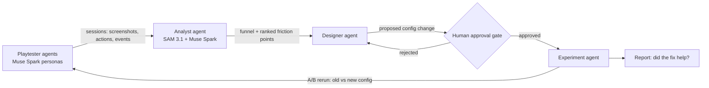

# Meta Game Onboarding Optimizer

**A closed-loop, multi-agent system that playtests a game's onboarding, finds where new players get stuck, proposes fixes, and verifies them with A/B reruns, with a human approving every change.**

Built for the [Meta Global AI Developer Hackathon](https://cerebralvalley.ai/e/meta-ai-developer-hackathon) (Oct 26 – Nov 4, 2026) · Problem statement: **Build for Your World**

> 🚧 Work in progress. All code in this repository is written during the hackathon.

## Why

The first minutes decide whether a player stays. Game teams find onboarding friction through playtests and funnel analysis, which is slow and expensive, and every fix needs another round of testing. This project closes that loop with agents: play → diagnose → fix → approve → verify.

## How it works



1. **Playtester agents.** Muse Spark agents with different player personas (e.g. impatient casual, careful completionist, first-time gamer) play a browser game through computer use: they look at the screen and act.
2. **Analyst agent.** It uses SAM 3.1 to segment UI elements in gameplay screenshots and Muse Spark to reason over sessions. It builds an onboarding funnel and ranks friction points (where personas hesitate, fail, or drop off).
3. **Designer agent.** It proposes concrete onboarding config changes, such as tutorial steps, hints, pacing or difficulty.
4. **Human approval gate.** No change is applied until a human approves it.
5. **Experiment agent.** It reruns the playtesters on the old and new configs as an A/B comparison and reports whether the fix improved the funnel.
6. **Validation.** Agent findings are compared against real human play sessions.

## Meta models used

| Model | Role |
|---|---|
| Muse Spark | Persona playtesters (computer use), session reasoning, fix proposals |
| SAM 3.1 | Segmenting UI elements and game state in screenshots |
| Muse Image | High-salience Variant B UI emblem generation (closed-loop Designer fix) & isometric asset/portrait upgrades |

## Status

- [x] Browser game with config-driven onboarding and event logging (2.5D isometric, Dawn Age to Stone Age)
- [x] Config, patch and human approval gate backend (FastAPI, Pydantic)
- [x] Unbiased telemetry: raw events, server-derived `stuck` events and run summaries
- [x] In-game AI Director dock: Telemetry Pill, live stream, patch diff, Approve/Reject, A/B tab
- [x] Side-by-side replay of two recorded runs
- [x] Stub persona bot behind Watch Bot Play (offline placeholder, labelled STUB)
- [ ] Playtester agents with Muse Spark (computer use)
- [ ] Analyst: funnel and friction ranking (SAM 3.1 plus Muse Spark)
- [ ] Designer agent proposing patches
- [ ] Experiment agent: A/B reruns and report
- [ ] Validation against human sessions
- [ ] Demo video

The onboarding friction in the base config is planted on purpose, so the loop has a known problem to find. At `onb_03_handoff` the Woodcutter Hut is unlocked and marked NEW!, while the Research button is small. A player who builds the hut drops below the 30 wood that Basic Toolmaking needs, and the hut produces nothing without that tech. `configs/patches/patch_001.json` is a hand-written seed patch for the approval-gate demo until the designer agent exists.

## Getting started

You need Python 3.11 and [uv](https://docs.astral.sh/uv/).

```bash
uv venv && uv pip install -e .
.venv/bin/playwright install chromium
.venv/bin/uvicorn backend.app:app --port 8000
```

Open these URLs on `http://localhost:8000`:

| URL | What it shows |
|---|---|
| `/?variant=A&seed=42` | Base config (planted friction) |
| `/?variant=B&patch_id=patch_001&seed=42` | Patched config; returns 403 until a human approves `patch_001` in the AI Director |
| `/?variant=A&bot=1&persona=impatient_newcomer&speed=4` | Watch Bot Play with the stub persona policy |
| `/?replay_a=<run_id>&replay_b=<run_id>&speed=4` | Side-by-side replay; add `&dev=1` for runs not played by Muse Spark |
| `/?variant=A&inspect_config=1` | Config inspector: which lever drives which UI element |

Other URL parameters: `seed`, `speed` (1 to 4), `run_id`, `telemetry=0`. Runs are written to `runs/<run_id>/` (`events.jsonl`, `bot_steps.jsonl`, `summary.json`, `resolved_config.json`).

The Meta API key is read only inside the app from `.env` (`META_API_KEY=...`). Do not export it in your shell.

Run the tests (unit tests plus headless Playwright end-to-end and layout tests):

```bash
.venv/bin/python -m pytest -q
```

## Author

**Timur Salakhetdinov** · [Portfolio](https://timursalakhetdinov.com) · [LinkedIn](https://www.linkedin.com/in/timursalakhetdinov) · [GitHub](https://github.com/TimurSalakhetdinov)
