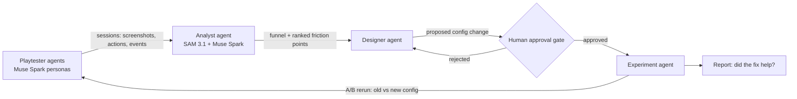

# Meta Game Onboarding Optimizer

**A closed-loop, multi-agent system that playtests a game's onboarding, finds where new players get stuck, proposes fixes, and verifies them with A/B reruns, with a human approving every change.**

Built for the [Meta Global AI Developer Hackathon](https://cerebralvalley.ai/e/meta-ai-developer-hackathon) (Oct 26 – Nov 4, 2026) · Problem statement: **Build for Your World**

> 🚧 Work in progress. All code in this repository is written during the hackathon.

## Why

The first minutes decide whether a player stays. Game teams find onboarding friction through playtests and funnel analysis, which is slow and expensive, and every fix needs another round of testing. This project closes that loop with agents: play → diagnose → fix → approve → verify.

## How it works

1. **Playtester agents.** Muse Spark agents with different player personas (e.g. impatient casual, careful completionist, first-time gamer) play a browser game through computer use: they look at the screen and act.
2. **Analyst agent.** It uses SAM 3.1 to segment UI elements in gameplay screenshots and Muse Spark to reason over sessions. It builds an onboarding funnel and ranks friction points (where personas hesitate, fail, or drop off).
3. **Designer agent.** It proposes concrete onboarding config changes, such as tutorial steps, hints, pacing or difficulty.
4. **Human approval gate.** No change is applied until a human approves it.
5. **Experiment agent.** It reruns the playtesters on the old and new configs as an A/B comparison and reports whether the fix improved the funnel.
6. **Validation.** Agent findings are compared against real human play sessions.

## Meta models used

| Model | Role |
|---|---|
| Muse Spark | Persona playtesters (computer use), session reasoning, fix proposals |
| SAM 3.1 | Segmenting UI elements and game state in screenshots |

## Status

- [ ] Browser game with config-driven onboarding and event logging
- [ ] Playtester agents (computer use)
- [ ] Analyst: funnel + friction ranking
- [ ] Designer agent + human approval gate
- [ ] Experiment agent: A/B reruns and report
- [ ] Validation against human sessions
- [ ] Demo video

## Getting started

_Setup and run instructions coming soon._

## Author

**Timur Salakhetdinov** · [Portfolio](https://timursalakhetdinov.com) · [LinkedIn](https://www.linkedin.com/in/timursalakhetdinov) · [GitHub](https://github.com/TimurSalakhetdinov)
