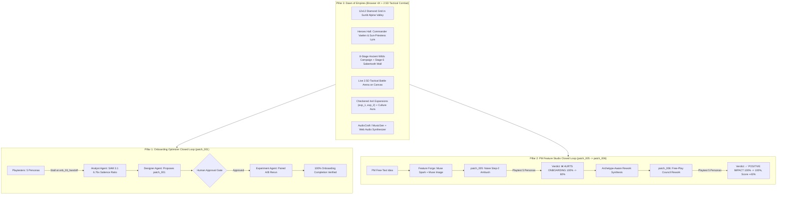

# Agent Handover Guide: Meta Game Onboarding Optimizer ("Dawn of Empires")

> **Target Audience:** Any coding agent (Claude Opus/Sonnet in Antigravity, Gemini 3.8 / 4 Argon, or Muse Code) taking over development.
> **Last Updated:** October 28, 2026 (Session 4 — Dawn of Empires Full Overhaul Complete).
> **Submission Deadline:** Wednesday, November 4, 2026, 9:00 PM ET (Thursday, November 5, 03:00 Berlin).

---

## 1. Current Git Branch & Repository State

- **Branch:** `main` (clean, all features merged).
- **Test Suite Status:** **92+ tests passing** (`.venv/bin/python -m pytest -q`). Zero failures, zero regressions.
- **Provider Mode Default:** `stub` mode (`META_PROVIDER=stub` / offline). All automated tests run at **$0.00 Meta API cost**.
- **Working Tree:** All code, configs, demo runs, and documentation are committed. No uncommitted temporary files or exposed secrets.

---

## 2. Quickstart & Verification Commands

All Python tools run inside the local virtual environment (`.venv`):

### A. Run the Complete Test Suite
```bash
.venv/bin/python -m pytest -q
```
Runs unit tests, schema validators, agent logic tests, and headless Playwright integration tests.

### B. Start the Unified Server (Backend API + Game Frontend)
```bash
.venv/bin/uvicorn backend.app:app --host 127.0.0.1 --port 8000
```
Serves the FastAPI API and static game frontend at `http://localhost:8000`.

### C. Run the Playwright 6-Screen Visual Audit
```bash
# Ensure the server is running on port 8000 in another terminal, then:
.venv/bin/python scratch/verify_hoh_overhaul.py --base-url http://127.0.0.1:8000
```
Captures 6 high-resolution (1400x800) audit screenshots in `scratch/screenshots/`:
1. `01_alpine_valley_city.png`: Sunlit Alpine Valley, waterfall cliffs, southern river, 4x4 expansion sectors, culture aura.
2. `02_heroes_hall.png`: `🛡️ Heroes` modal with Commander Vaelen and Sun-Priestess Lyra.
3. `03_campaign_map_8stages.png`: `⚔️ Campaign` modal showing Province 1: Ancient Wilds (Stages 1–8).
4. `04_tactical_battle_arena_cutin.png`: Live 2.5D Tactical Combat Arena on canvas with ultimate cut-ins.
5. `05_stage6_defeat_and_victory.png`: Stage 6 Defeat Recovery screen (`[🛡️ Level Up Your Team]`).
6. `06_quest_ledger_6chapters.png`: 6-Chapter Questlines Ledger modal.

### D. Run the Closed Loop in Stub Mode ($0 API Cost)
```bash
# Run full closed loop (A baseline play -> SAM analysis -> Designer patch -> Approval -> B rerun)
.venv/bin/python -m backend.cli run-closed-loop --mode stub --seeds 42,44

# Run single session
.venv/bin/python -m backend.cli run-session --variant A --persona impatient_newcomer --seed 42 --mode stub
```

---

## 3. Architecture Summary: The Three Core Pillars

The project implements two closed-loop multi-agent workflows built on top of a rich historical 4X browser game:



### Pillar 1: Onboarding Optimizer Loop (`patch_001`)
- **Planted Baseline Friction:** In `configs/base_config.json`, tutorial step `onb_03_handoff` unlocks the Woodcutter Hut with prominent `NEW!` styling while the Research button is rendered with `"low"` salience. Rush-clickers spend their starting wood on the hut, falling below the 30 wood required for Basic Toolmaking. Because the hut produces nothing without toolmaking, the player deadlocks.
- **Analyst Diagnosis:** SAM 3.1 segments gameplay screenshots, computing a **`6.76x` distractor-to-goal visual salience ratio** (Woodcutter card area vs. Research button). The Analyst pairs this with think-aloud quotes and session metrics.
- **Designer Patch (`configs/patches/patch_001.json`):** Locks optional builds until `onb_03_handoff`, sets `research_button_salience = "high_pulse"`, increases starting wood, and shortens hint delay.
- **Human Approval Gate:** Strict `403 Human approval required` blocks activation until approved in the dock or CLI.
- **Experiment Verification:** McNemar exact test and paired bootstrap CI demonstrate **100% onboarding completion** on Variant B.

### Pillar 2: PM Feature Studio Loop (`patch_005` & `patch_006`)
- **Architect's Council Dock (`#right-dock`):** Features `📜 Feature Forge` (free-text prompt to schema-validated `FeaturePlugin`), `🏛️ Council Report` (1-click switcher between Naive and Rework reports), and `👁️ Live Chronicle`.
- **Pre-Baked HURTS → POSITIVE Bundle:**
  - `patch_005.json` (Naive Step-2 Raider Ambush): 55 wood cost at step 2 -> `❌ HURTS ONBOARDING` (completion drops 100% -> 60%, Stone Age drops 40% -> 0%, score drops 145 -> 73.6).
  - `patch_006.json` (Council Rework): Moves ambush to free play with balanced 10 food cost -> `✅ POSITIVE IMPACT` (completion 100% -> 100%, Stone Age 40% -> 60%, score climbs 145 -> 208).
  - **Committed Artifacts:** 20 stripped run directories in `runs_demo/` (5 personas x 2 arms x 2 patches) allowing 100% offline side-by-side replay at zero runtime cost.

### Pillar 3: Dawn of Empires 2.5D Systems Overhaul
- **Lush Sunlit Alpine Valley (`iso_renderer.js`):** Replaces flat ocean boxes with full-bleed `valley_backdrop.jpg`, northern limestone cliffs with animated cascading waterfalls, southern mountain river with stone arch bridge, dense pine/oak forests, 3 drifting parallax cloud shadows, grazing sheep, and flying birds.
- **28 Transparent PNG Sprites + 4 Painted Backdrops (`sprites.js`, `scripts/cutout_sprites.py`):** 28 transparent isometric PNG sprites across 7 style sheets (`preview_settlement_style_1..7.jpg`) cut out into `frontend/static/assets/sprites/`, plus 4 painted backdrops (`valley_backdrop.jpg`, `battle_arena_bg.jpg`, `campaign_map_bg.jpg`, `hero_hall_bg.jpg`).
- **Territory Expansions (`exp_1`, `exp_2`):** Checkered 4x4 expansion sectors on the flanks unlock building pads 9–12 with animated smoke rings and flying timber/rock particles.
- **Sacred Obelisk Culture Aura (`tribal_monument`):** Pulsing lime-green radial diamond aura extending 3 tiles, granting `+20%` harvest yields and coin generation to adjacent Small Homes and Rural Farms (`😊 +20%` euphoria badges).
- **`⚡ FREE` Instant-Finish & Bezier Collect Arcs:** Instant-finish chip on buildings under construction; harvesting spawns 6 Bezier flying particles curving into HUD resource counters.
- **Hero Roster & Level-Up Hall (`🛡️ Heroes` Modal):** Commander Vaelen (Infantry Vanguard Tank) and Sun-Priestess Lyra (Mystic Healer Lv.1–7). Stats and power formula: `power = Math.round(hp * 0.45 + atk * 2.2 + def * 1.8) + (abilityLevel - 1) * 35`.
- **8-Stage Ancient Wilds Campaign Map (`CAMPAIGN_STAGES`):** Stages 1–8 with Stage 6 Sabertooth Canyon Level-Check Wall (squad wipes if `squadPower < 460`, triggering DEFEAT recovery) and Stage 8 Alpha Shadowclaw Boss.
- **Live 2.5D Tactical Combat Arena:** Canvas battle mode with `battle_arena_bg.jpg`, marching heroes, beast packs, split Green/Red HP bar, bottom Hero Rage cards, 0.9s diagonal Comic-Book portrait slash cut-ins, 3-Star Victory Chest, and Stage 6 Defeat Recovery screen linking to Heroes Hall.
- **6-Chapter Questlines Ledger Modal:** Accessible from `#quest-card` (`data-target="btn_quest_ledger"`), covering Chapter I–VI narrative arcs with lore from Archon Solon.
- **Dual-Engine Soundtrack & Audio Engine (`audio.js`, `scripts/generate_music_tracks.py`):** Meta AudioCraft / MusicGen (`facebook/musicgen-small`) pipeline generating seamless 16s Alpine Valley (`valley_theme.wav`) and 12s 120 BPM Battle (`battle_theme.wav`) soundtrack loops, backed by an autonomous Web Audio physical-modeling synthesizer fallback inside `audio.js` with smooth 0.85s gain crossfading and physical-modeling SFX.
- **Telemetry Extensions:** Added `battle_lost`, `hero_leveled`, `territory_expanded`, and `hero_unlocked` to `EventType`. Non-progress handling in `_is_progress()`, `battles_lost` and `hero_levelups` counters in `compute_summary`, and `combat_wall_underleveled_heroes` hypothesis in Analyst agent diagnosis (`backend/agents/analyst.py`).

---

## 4. Strict Hard Rules (`AGENTS.md`)

These rules are non-negotiable. Every agent must adhere to them:

1. **NEVER export `META_API_KEY` globally in the shell:**
   - Exporting the key makes Muse Code billing draw against the hackathon's $150 credit budget instead of Timur's active subscription.
   - Load `META_API_KEY` exclusively inside application processes via python-dotenv (`.env`).
2. **Coding Tool Authentication:**
   - Muse Code: Run via `muse exec` using subscription login.
   - Claude / Gemini: Run in Antigravity or authorized sandbox sessions.
3. **Budget Caps & Cost Control:**
   - The total Meta API credit budget is **$150**.
   - Default model id: `muse-spark-1.3-contributor` (~12x cheaper than standard).
   - Hard caps enforced in `configs/budget_config.json`: $2 per session cap, global stop at $140.
   - Keep automated test suites in `stub` mode (`$0.00`). Never burn credits on unit tests.
4. **Human Approval Gate:**
   - Every config patch and PM feature patch MUST pass through the human approval gate. Never bypass or auto-apply.
5. **100% Original Lore & IP:**
   - Use our original names only: *Dawn of Empires*, *Commander Vaelen*, *Sun-Priestess Lyra*, *Archon Solon*, *Elder Kaelen*, *Alpha Shadowclaw*, *Province 1: Ancient Wilds*.
   - Never reference external game titles, third-party studios, or InnoGames IP.
6. **Public Repository Cleanliness:**
   - Keep commits, commit messages, and documentation clean, modular, and professional.

---

## 5. Remaining Milestones Before the Nov 4 Deadline

| Milestone | Target Window | Description & Key Deliverables |
|---|---|---|
| **Live Meta API Playtest Run** | Oct 29 – Oct 31 | Run the first live `META_PROVIDER=meta` playtest session batch (~$15–$25 budget) using SAM 3.1 set-of-mark and Muse Spark contributor mode. Validate real vision masks and reasoning quotes in `runs/`. |
| **Human Playtester Validation** | Oct 31 – Nov 2 | Conduct 5–10 real human play sessions on Variant A vs. Variant B. Compare human churn points against the agent-discovered `6.76x` visual salience bottleneck. |
| **Demo Video Production** | Nov 2 – Nov 4 | Record the 180-second submission video strictly following [`docs/video-script.md`](file:///Users/timursalakhetdinov/Documents/GitHub/meta-ai-hackathon/docs/video-script.md). Showcase the closed loop: play → diagnose (SAM 3.1 6.76x) → fix (patch_001) → approve → verify, plus the PM Feature Studio. |
| **Submission Packaging** | Nov 4 (Evening) | Verify logged-out public GitHub repo, test Hugging Face Spaces / Docker zero-cost demo deployment, and submit on the Cerebral Valley platform. |

---

## 6. Key File & Directory Map

- **Game Frontend:**
  - `frontend/static/game.js`: Core simulation state, economy, heroes, combat engine, quests.
  - `frontend/static/iso_renderer.js`: Full-bleed Alpine Valley rendering, sprites, cloud shadows, particles, combat arena canvas mode.
  - `frontend/static/sprites.js`: Sprite manifest (28 PNGs + 4 backdrops) and loader.
  - `frontend/static/audio.js`: Dual-engine soundtrack player (MusicGen WAVs + procedural Web Audio) and SFX bus.
  - `frontend/static/overlay.js`: Architect's Council dock (`#right-dock`), Feature Forge, Council Report, Live Chronicle.
- **Backend Services & Agents:**
  - `backend/app.py`: FastAPI server, static file mounting, API endpoints.
  - `backend/schemas.py`: Pydantic v2 schemas (`GameConfig`, `FeaturePlugin`, `TelemetryEvent`, `EventType`).
  - `backend/config_service.py`: Patch application, Pydantic validation, human approval gate.
  - `backend/telemetry.py`: Raw event ingestion, server-side `stuck` derivation, summary calculation.
  - `backend/meta_client.py`: SAM 3.1 & Muse Spark API adapter, Set-of-Mark generation, token ledger, cache.
  - `backend/bot_runner.py`: Async Playwright bot runner with working-memory scratchpads.
  - `backend/agents/analyst.py`: Stuck frame extraction, visual salience calculation, hypothesis formulation.
  - `backend/agents/designer.py`: Config patch proposal engine.
  - `backend/agents/experiment.py`: Paired A/B experiment runner, McNemar & bootstrap statistical report.
  - `backend/feature_studio.py`: Free-text PM feature parser, verdict engine, archetype-aware rework generator.
- **Configs & Assets:**
  - `configs/base_config.json`: Immutable baseline config with planted onboarding friction.
  - `configs/patches/`: Approved patches (`patch_001.json`, `patch_005.json`, `patch_006.json`).
  - `runs_demo/`: Committed demo run artifacts for offline zero-cost replay.
  - `scripts/cutout_sprites.py`: Background removal script for isometric sprites.
  - `scripts/generate_music_tracks.py`: Meta AudioCraft / MusicGen soundtrack generator.
  - `scratch/verify_hoh_overhaul.py`: 6-screen Playwright visual audit script.
