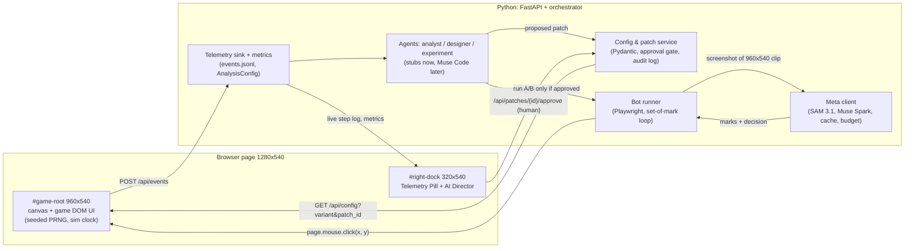
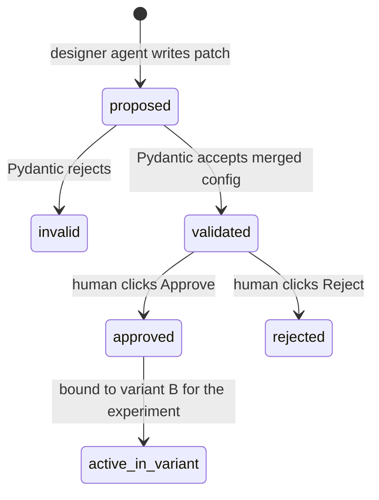

# Architecture: game foundation and bot connection layer

High-level design for the two-day build (Oct 27–29) of the browser game, the config and patch system, telemetry, and the bot connection to Meta models. Agent logic (analyst, designer, experiment) starts as stubs here and is written in Muse Code from Oct 29. The demo storyline is in [`video-script.md`](video-script.md); the build task for Claude Code is in [`tasks/claude-code-build-game.md`](tasks/claude-code-build-game.md).

Reviewed with Gemini 4 Argon over five rounds (see [`hackathon/argon-review-log.md`](hackathon/argon-review-log.md)). Numbers below are design defaults, not measurements.

## 1. Goals and non-goals

**Goals by the end of Oct 29**
1. A playable, original, config-driven city-builder covering three onboarding steps (`onb_01_shelter`, `onb_02_forager`, `onb_03_handoff`) and early free play up to a first achievement.
2. A validated config system: immutable base config plus patches, with a human approval gate.
3. Deterministic runs: seeded randomness and a simulation clock with a speed factor.
4. Telemetry: raw game events and bot decisions as JSONL, with metrics computed by a fixed, versioned analysis rule.
5. A Python + Playwright bot loop using SAM 3.1 marks and Muse Spark decisions (with cache, budget guard and a stub mode).
6. The whole loop (play → diagnose → propose → approve → rerun) running end to end on stubs, with tests.

**Non-goals**
- No standalone dashboard and no Streamlit (anti-projects). Everything shows in the in-game right column.
- No units, pathfinding, combat or isometric camera. Fixed building pads on a 2D canvas.
- No runtime code changes. Runtime changes are schema-validated JSON patches only.
- No automatic patch deployment. Every patch stops at the human approval gate.
- No InnoGames data, code, configs or screenshots. Original code and assets only.

## 2. Components



| Component | Location | Responsibility |
|---|---|---|
| Game frontend | `frontend/static/` | Settlement canvas, resource bar, advisor, build bar, Research panel, first achievement. Emits raw events. Exposes `window.__GAME_STATE__` (idle flag, click sequence) and, for stub/debug only, `window.__GAME_DEBUG__.getRenderedTargets()`. |
| Right dock | `frontend/static/overlay.js` | **Telemetry Pill** (top: step id, time to first action, onboarding checklist) and **AI Director** panel (tabs: Live bot, Analyst and Designer with approval gate, A/B summary). Lives outside the game area. |
| Replay player | `frontend/static/replay.js` | `/?replay_a=<run>&replay_b=<run>&speed=4`: side-by-side playback from recorded artifacts on one timeline, no API calls. Refuses runs whose `provider_mode` is not `meta` unless `?dev=1`. |
| Config & patch service | `backend/config_service.py` | Loads `configs/base_config.json`, applies patches, validates with Pydantic, enforces the approval gate, writes the audit log. |
| Telemetry sink | `backend/telemetry.py` | Appends events to `runs/<run_id>/events.jsonl`, derives `stuck` with `AnalysisConfig`, writes `summary.json`. |
| Bot runner | `backend/bot_runner.py` | Async Playwright. One fresh `BrowserContext` and fresh bot memory per session. Opens the game with URL params, waits for idle, captures the 960x540 clip, calls the Meta client, draws the cyan click ring, clicks, records video and frames. |
| Meta client | `backend/meta_client.py` | SAM 3.1 segmentation and set-of-mark rendering, Muse Spark decisions (configurable model id, contributor by default), disk cache (Muse cache off in experiment mode), cost ledger and budget buckets, provider switch `stub` / `open_weights` / `meta`, `META_CACHE_ONLY` mode. |
| Agents | `backend/agents/` | `analyst.py`, `designer.py`, `experiment.py` with typed interfaces and deterministic stub outputs. `experiment.py` owns the worker pool and paired statistics. Real reasoning is written in Muse Code from Oct 29. |
| CLI | `backend/cli.py` | `run-session`, `run-closed-loop`, `replay` commands. |

## 3. Stack and repo layout

- **Python 3.11, FastAPI, Playwright (async), Pydantic v2, Pillow.** Matches the repo plan (Python for agents, orchestrator and analysis). FastAPI serves the API and the static game from one process: `uvicorn backend.app:app`.
- **Plain JavaScript ES modules, HTML5 Canvas and CSS**, served as static files. No Node, npm or bundler: one less toolchain in a two-day build, and the game is small. (Argon first proposed Node + TypeScript; we chose Python plus plain JS.)
- **Flat files, no database.** Each run is a self-contained folder that can be replayed offline when credits run out.

```text
configs/
  base_config.json        # immutable baseline, contains the planted handoff friction
  analysis_config.json    # fixed stuck rule, versioned (not patchable)
  budget_config.json      # budget buckets, caps, muse_model_id, worker pool size
  personas.json           # persona prompts (3 experiment personas)
  experiment_config.json  # seeds (8), personas, run type, MAX_BOT_STEPS per run type
  patches/
    patch_001.json        # patch body + metadata + status
    audit_log.jsonl       # append-only lifecycle transitions
frontend/static/
  index.html  styles.css  main.js  clock.js  game.js  overlay.js  replay.js
backend/
  app.py  schemas.py  config_service.py  telemetry.py
  bot_runner.py  meta_client.py  cli.py
  agents/  analyst.py  designer.py  experiment.py
tests/
runs/                     # gitignored; selected demo runs copied to runs_demo/ if needed
  <run_id>/  resolved_config.json  events.jsonl  bot_steps.jsonl  summary.json
             frames/  som_masks/  video/
  checkpoints/<baseline>/<persona>_<seed>.json   # stretch: golden early-play checkpoints
  .cache/  cost_ledger.jsonl  ab_summary.json  voiceover_sheet.txt
```

## 4. Config schema and edit flow

### Schema
A flat JSON object, so the keys in the video read exactly as in the code. Fields are grouped into four lever groups only. Defaults are design values for the baseline.

```python
StepId = Literal["onb_01_shelter", "onb_02_forager", "onb_03_handoff", "free_play"]

class GameConfig(BaseModel):
    model_config = ConfigDict(extra="forbid")
    # 1. Economy
    starting_wood: int = Field(60, ge=0, le=500)
    starting_food: int = Field(40, ge=0, le=500)
    shelter_wood_cost: int = Field(20, ge=5, le=200)
    forager_wood_cost: int = Field(20, ge=5, le=200)
    optional_woodcutter_cost: int = Field(30, ge=5, le=200)
    research_toolmaking_wood_cost: int = Field(30, ge=5, le=200)
    # 2. Tutorial steps and locks
    lock_optional_builds_until_step: Optional[StepId] = None
    # 3. UI salience
    research_button_salience: Literal["low", "medium", "high_pulse"] = "low"
    build_button_scale: float = Field(1.0, ge=0.8, le=1.5)
    # 4. Pacing
    idle_hint_delay_sec: float = Field(15.0, ge=1.0, le=60.0)
    forager_cycle_sec: float = Field(4.0, ge=1.0, le=30.0)
    first_achievement_target_score: int = Field(100, ge=50, le=500)

class GameConfigPatch(BaseModel):   # same fields, all optional, extra="forbid"
    ...
```

**Planted baseline friction.** Starting wood covers the shelter and the forager plus Research, but only if the player does not build the optional Woodcutter Hut. With `lock_optional_builds_until_step = null` and `research_button_salience = "low"` (small, low-contrast, icon-only), an impatient player builds the hut, runs short of wood and stalls at `onb_03_handoff`. The intended fix touches all four lever groups: lock optional builds until `onb_03_handoff`, `high_pulse` salience, more starting wood, a shorter hint delay.

### Patch format and merge
- Patches are flat partial objects validated by `GameConfigPatch` (`extra="forbid"`, ranges enforced).
- Merge: `merged = base.model_dump() | patch.model_dump(exclude_unset=True)`, then `GameConfig.model_validate(merged)`. An explicit `null` is a real value (for example "no lock"); omitted keys stay unchanged. This is deliberately not RFC 7396, where `null` deletes a key.
- **Validation is Pydantic / JSON Schema at runtime.** Muse Code is only a coding tool and never runs inside the product.

### Lifecycle and approval gate



- The designer agent can only create `proposed` patches. Only `POST /api/patches/{id}/approve` from the AI Director (or an explicit CLI prompt that a person answers) moves a patch to `approved`.
- The config endpoint and the experiment runner refuse an unapproved patch (`403 Human approval required` / `ApprovalRequiredError`).
- `audit_log.jsonl` records every transition: `timestamp_iso, patch_id, from_state, to_state, actor (designer_agent | validator | human), diff, base_config_sha256`.

## 5. Telemetry and metrics

The game emits **raw events only**. `stuck` is derived on the Python side with a fixed `AnalysisConfig` that is not part of `GameConfig`, so patching `idle_hint_delay_sec` cannot change how stuck is measured.

```json
{"run_id": "run_A_seed42_...", "variant_id": "A", "patch_id": null, "persona_id": "impatient_newcomer",
 "seed": 42, "time_scale": 2.0, "provider_mode": "meta", "wall_ts_ms": 0, "sim_elapsed_sec": 14.2,
 "step_id": "onb_03_handoff", "event_type": "action_rejected", "bot_step_index": 12, "correlation_id": "c-12",
 "payload": {"target_id": "btn_research", "reason": "insufficient_wood", "wood_available": 0, "wood_required": 30}}
```

- Game event types: `session_start`, `step_enter`, `step_complete`, `click`, `action_rejected`, `hint_shown`, `achievement`, `session_end`.
- Derived event (Python): `stuck`, tagged with `analysis_version`.
- `AnalysisConfig` (versioned, fixed across variants): `stuck_idle_sim_sec` (no state-advancing action for this long in simulated time) and `stuck_rejected_streak` (consecutive rejected or no-op clicks in one step).

**Bot decisions** go to a separate `bot_steps.jsonl`: `run_id, bot_step_index, correlation_id, sim_elapsed_sec, provider_mode, model_id, model_mode, frame_phash, sam_cache_hit, sam_marks_count, sam_latency_ms, muse_cache_hit, muse_latency_ms, prompt_tokens, completion_tokens, estimated_cost_usd, bucket, observation_summary, thought, chosen_mark_id, target_xy`. Before each click the runner sets `window.__BOT_CTX__ = {bot_step_index, correlation_id}` so the resulting game events carry the same ids. The AI Director Live tab shows the joined view (decision, then outcome).

**Metrics** (`summary.json`, computed from `events.jsonl`):
- `time_to_first_action_sec`: simulated time of the first `click`.
- `stuck_events`: count of derived `stuck` events.
- `where_stuck`: the step with the most `stuck` events, or the unfinished step at `session_end`; `null` if none.
- `onboarding_completed`: `step_complete` for `onb_03_handoff` before `session_end`; `first_achievement` reported separately.
- Timestamped step log: ordered `sim_elapsed_sec, step_id, event_type, summary`.

## 6. Bot interface

**Layout.** Page viewport 1280x540, `device_scale_factor=1`. `#game-root` (0–960 px) holds the canvas and the game's DOM UI. `#right-dock` (960–1280 px) holds the Telemetry Pill and AI Director. The bot captures `page.screenshot(clip={x:0, y:0, width:960, height:540})`, so it never sees its own metrics; the runner asserts that no dock element intersects the clip. Screenshot pixels map 1:1 to click coordinates.

**Observation.** The 960x540 frame with SAM 3.1 set-of-mark overlay (numbered outlines on up to K≈8 interactive regions after filtering tiny or background masks), plus a short text memory of the last 3 actions and the time spent in the current step. No DOM ids or config values.

**Decision (Muse Spark, structured JSON):**
```json
{"observation_summary": "...", "thought": "...", "action": "click_mark", "mark_id": 3, "fallback_xy": [310, 490]}
```
The runner clicks the centroid of the chosen mask (or `fallback_xy`), draws the cyan ring, then waits for `window.__GAME_STATE__` to report idle with the new click sequence before the next capture.

**Personas** (`configs/personas.json`), the three used in every experiment: `first_time_casual` (reads the tutorial, acts carefully, gets lost in a crowded UI), `impatient_newcomer` (rush-clicker: skips text, clicks the most prominent affordable thing; the demo persona), `optimizer` (min-maxer: counts resources, looks for bottlenecks). Prompts are tuned later in Muse Code.

**Fresh state per session.** Each session gets a new Playwright `BrowserContext` (no `localStorage` / `IndexedDB` carry-over) and a new bot memory (message history, last-actions memory, scratchpad). Nothing is shared between sessions except the read-only SAM cache.

**Loop and stop conditions.** One model call per stable idle state, never per frame. Stop on `first_achievement` (success, onboarding runs), `MAX_BOT_STEPS`, or `stuck_abort` after 3 derived stuck events in the same step. `MAX_BOT_STEPS` depends on the run type: ~25 for `onboarding` runs (from `t=0`), ~100 for `full_window` runs (0-20 min, ~80 steps expected). Full-window runs continue past the first achievement until the 20-minute sim mark.

**Vision policy.**
- Recorded and reported runs use honest vision: SAM 3.1 marks on the screenshot, Muse Spark picks the mark.
- `?assist=true` debug fallback: if SAM fails, `__GAME_DEBUG__` supplies boxes for numbering while Muse Spark still decides from the image. Every run records `vision_mode` (`sam_3_1` or `debug_fallback`).
- **Stub mode** (dev and tests only): a heuristic policy that reads `getRenderedTargets()` (visible, locked, affordable, computed salience) and picks by a salience score with seeded tie-breaks. It never reads `variant_id` or config files. Non-`meta` runs show a yellow `STUB / DEV MODE — NOT LIVE MUSE SPARK` banner and are never shown in the video; the experiment runner refuses to mix provider modes.

## 7. Determinism and A/B serving

- `mulberry32(seed)` drives all randomness; `?seed=` in the URL.
- One simulation clock: `sim.advance(realDelta * speed)`, `?speed=1..4`. Events log both wall and simulated time, so metrics do not depend on playback speed.
- Variants by URL: `/?variant=A&seed=42&persona=impatient_newcomer&speed=2` and `/?variant=B&patch_id=patch_001&seed=42&...`. The page loads `GET /api/config?variant=…&patch_id=…`; the backend merges and validates, and refuses unapproved patches.
- Experiment matrix (`configs/experiment_config.json`): 3 personas x 8 fixed seeds (`42`-`49`) = 24 sessions per variant, 48 per A/B pair, paired by `(persona, seed)`. Variation comes from seeds and personas, not LLM temperature.
- Experiment runner: one **canary** session first (abort the batch if it crashes or its tokens/cost are far above the estimate), then a **worker pool** of parallel sessions (`worker_pool_size`, default 5, configurable; 1 = sequential for debugging). Each worker uses its own fresh `BrowserContext`. Same model id, mode and provider for every session in an experiment; the runner refuses to mix them.
- Run types: `onboarding` (from `t=0`, for patches that touch the first 10 minutes) and `full_window` (0-20 min end to end, also the final validation). No survivor filtering between stages.
- Baseline reuse: an approved B becomes the baseline of the next loop and is not rerun, as long as the pairs, seeds, model id and mode are unchanged.
- **Stretch: golden checkpoints.** For early-play patches that provably do not touch the first 10 minutes, a session may start from one saved state per `(persona, seed)` recorded on the current baseline. Never used when the patch touches onboarding. Skip if it complicates Day 1-2; end-to-end full-window runs are cheap enough in contributor mode.
- **Paired statistics** in `runs/ab_summary.json`: per pair outcomes for A and B; binary metrics (`onboarding_completed`, stuck yes/no) with McNemar's test (exact) and a 95% CI for the difference in proportions (Wilson or bootstrap); continuous metrics (`time_to_first_action_sec`, `stuck_events`) as `N`, `median_delta` and a paired bootstrap 95% CI (Wilcoxon signed-rank optional). Report N honestly; with 24 pairs only large effects are detectable.

## 8. Cost control for the $150 Meta credits

- **Model id.** `muse_model_id` in `configs/budget_config.json`, default `muse-spark-1.3-contributor` (contributor mode, ~12x cheaper; Meta may train on the content). One value switches to standard `muse-spark-1.3`. Every ledger line records `model_id` and `model_mode` (`contributor` | `standard`). SAM 3.1 has no contributor mode.
- **Cache.** SAM results keyed by a perceptual hash of the game frame: always on. Muse Spark responses keyed by `sha256(model_id, persona, prompt_version, frame_phash, last_actions)`: **disabled in experiment mode**, because identical starts would share one cached decision and turn N sessions into one. The Muse cache is written and read only for replay/recording (`META_CACHE_ONLY=1`), parser debugging and stub tests.
- **Budget buckets** (`configs/budget_config.json`, following `docs/plan.md`): dev ~5%, playtester runs ~70%, analysis ~10%, reserve ~15%; global stop at $140. Every call records its bucket, model id and mode in `runs/cost_ledger.jsonl` and checks the bucket, the global stop and a per-session cap ($2, configurable). The cap checks must be safe under parallel workers (one lock around the ledger). Reserve spending needs an explicit `--use-reserve` flag. Over budget raises `BudgetCapExceededError` and falls back to cache.
- **Provider switch** `META_PROVIDER = stub | open_weights | meta`. Most building and testing runs on `stub`; prompt tuning on open-weights models via Baseten or Modal credits; `meta` for calibration and recorded runs.
- **`META_CACHE_ONLY=1`** drives a real browser session from cached decisions only, for recording and for the Nov 9 live final if credits have expired.
- **Estimate** (planning numbers in `docs/plan.md`; replace with the day-1 measurement of 3 full sessions):
  `cost ≈ N_runs × avg_steps × ((1 − h_sam) × [SAM call cost] + (1 − h_muse) × [Muse Spark call cost]) + N_loops × [analyst + designer cost]`.
- The API key is read inside the app from `.env` (python-dotenv). Never export `META_API_KEY` in the shell, never log or commit it.

## 9. Milestones

| Day | Build | Acceptance check |
|---|---|---|
| **Day 1 (Oct 27–28)** | FastAPI app and static serving; `schemas.py` (GameConfig, GameConfigPatch, AnalysisConfig, TelemetryEvent, BotStepRecord); config service with approval gate and audit log; the game with three onboarding steps, optional Woodcutter Hut, Research, first achievement; seeded clock; raw events; derived stuck; right dock with Telemetry Pill and AI Director (approval gate UI). | Manually playing `?variant=A&seed=42` and building the optional hut at the handoff yields `action_rejected` and a derived `stuck` in `events.jsonl`. Approving `patch_001` in the AI Director moves it `validated → approved`; `?variant=B&patch_id=patch_001` locks optional builds and pulses Research. Unapproved patch returns 403. |
| **Day 2 (Oct 28–29)** | Bot runner (clip capture, set-of-mark loop, click ring, idle barrier, video and frames, fresh context per session); Meta client (configurable model id, cache with experiment mode, buckets, ledger, provider switch, cache-only mode); experiment runner (canary + worker pool, paired stats); agent stubs; replay route; CLI `run-closed-loop`; tests; README run instructions; handoff note in `docs/plan.md`. | `python -m backend.cli run-closed-loop --mode stub --seeds 42,43` runs play A → diagnose → propose `patch_001` → human approve (CLI prompt) → paired A/B rerun (canary, then worker pool) and writes `ab_summary.json` with paired statistics. The default stub experiment over 3 personas x 8 seeds also completes. One live smoke run (`--mode meta --seed 42`) writes real `som_masks/`, logs cost, and replays at zero cost from cache. `pytest` passes. |

**Tests (Day 2):** config merge and validation (explicit null, extra keys rejected, ranges); approval gate (403 on unapproved); unbiased metrics (changing `idle_hint_delay_sec` does not change `stuck_events` for the same event trace); stub divergence (the variant-blind stub stalls on A and completes B on the same seed); cache and budget buckets; no Muse cache hit shared between experiment sessions; model id default and switch; paired statistics; fresh context per session; dock does not intersect the bot clip; end-to-end closed loop on stubs.

## 10. Risks and scope cuts

| Area | Risk | Cut or fallback |
|---|---|---|
| Art and animation | Hours lost on sprites and animation | Five fixed pads on a simple original background, CSS glow for construction, floating `+Wood` text. |
| Content depth | 20 minutes of real content is too much | Three onboarding steps plus a few free-play steps to the first achievement, compressed by `speed`. |
| Baseline does not stall live | Muse Spark reads "Research" and clicks it | Icon-only, small, low-contrast Research in the baseline; bright optional hut tile; check live early. |
| SAM noise or merges | Too many tiny masks or merged icons | Area filter, top K marks, 16 px spacing and borders, click mask centroids, cache by frame hash. |
| Latency and rate limits | Slow batches; contributor mode is limited to 150 RPM | Canary first, pool of ~5 workers (stays under 150 RPM), back off on 429. Never record the first uncached run; record with `META_CACHE_ONLY=1`. |
| Parallel runs on a bug | A broken prompt or selector burns credits fast | Canary session gates every batch; per-session $2 cap and global stop at $140. |
| A/B split-screen sync | Runs end at different times | Replay route on one shared timeline; freeze A with a `STALLED` badge while B finishes. |
| Coordinate drift | HiDPI or CSS scaling | Fixed 1280x540 viewport, `device_scale_factor=1`, fixed-position game root. |
| Credits expire before Nov 9 | Live final without API | Cached runs plus cache-only replay. |
