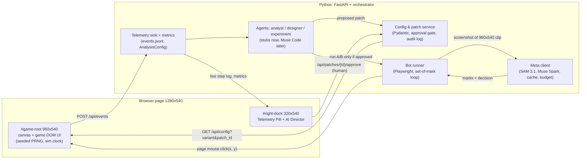
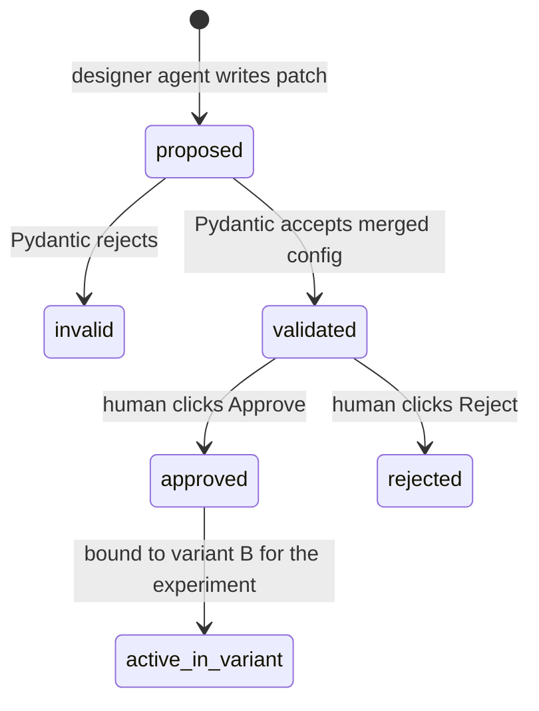

# Architecture: game foundation and bot connection layer

High-level design for the two-day build (Oct 27–29) of the browser game, the config and patch system, telemetry, and the bot connection to Meta models. Agent logic (analyst, designer, experiment) starts as stubs here and is written in Muse Code from Oct 29. The demo storyline is in [`video-script.md`](video-script.md); the build task for Claude Code is in [`tasks/claude-code-build-game.md`](tasks/claude-code-build-game.md).

Reviewed with Gemini 4 Argon over five rounds (see [`hackathon/argon-review-log.md`](hackathon/argon-review-log.md)). Numbers below are design defaults, not measurements.

## 1. Goals and non-goals

**Goals by the end of Oct 29 (Claude Code 2-day Game-First Sprint)**
1. A high-craft, original, config-driven **2.5D isometric historical city-builder** covering three guided onboarding steps (`onb_01_shelter`, `onb_02_forager`, `onb_03_handoff`) and rich early free play (`free_play`: population/worker management, 4 resources, 7 building types, a 5-node visual Tech Tree modal, and an Era Upgrade from *Dawn Age* to *Stone Age* for `first_achievement`).
2. Hybrid visual pipeline: isometric diamond grid (`12x12` tiles) with animated water shorelines, terrain props, walking villagers, scaffolding-to-building construction stages, floating resource popups, F2P strategy UI chrome (stone/gold/parchment HUD, Advisor portrait modal, Build carousel, Tech Tree modal), loading transparent PNG sprites (`frontend/static/assets/sprites/`, generated via Gemini Pro / Antigravity at `$0` Meta API cost) with rich procedural isometric Canvas/SVG fallback.
3. A validated config system (`backend/config_service.py`): immutable base config plus flat patches, with a human approval gate and audit log.
4. Deterministic runs: seeded randomness (`mulberry32`) and a simulation clock with a speed factor (`?speed=1..4`).
5. Telemetry (`backend/telemetry.py`): raw game events as JSONL, with unbiased `stuck` and summary metrics computed by a fixed, versioned `AnalysisConfig`.
6. In-game `#right-dock` (Telemetry Pill, AI Director with human Approve/Reject gate, and side-by-side Replay view) plus clean bot hooks (`window.__GAME_STATE__`, `window.__GAME_DEBUG__.getRenderedTargets()`, `window.__BOT_CTX__`) ready for the Oct 29+ Playwright + SAM 3.1 + Muse Spark pipeline.

**Goals for Oct 29 – Nov 4 (Muse Code + Antigravity)**
- Python + Playwright bot loop (`backend/bot_runner.py`) and Meta client (`backend/meta_client.py`) using SAM 3.1 marks and Muse Spark decisions (with cache, budget guard and a stub mode).
- Persona playtesters (`first_time_casual`, `impatient_newcomer`, `optimizer`), Analyst, Designer, and Experiment agents (`backend/agents/`) running the full closed loop.

**Non-goals**
- No standalone dashboard and no Streamlit (anti-projects). Everything shows in the in-game right column.
- No 3D modeling / Blender pipeline: 2.5D isometric sprites + layered Canvas/DOM polish gives a strategy F2P look in a two-day window.
- No combat or complex unit pathfinding (ambient villagers walk along fixed road/pad waypoints for visual life).
- No runtime code changes. Runtime changes are schema-validated JSON patches only.
- No automatic patch deployment. Every patch stops at the human approval gate.
- No InnoGames data, code, configs or screenshots. Original code and assets only.

## 2. Components



| Component | Location | Responsibility |
|---|---|---|
| Game frontend | `frontend/static/` | 2.5D isometric settlement canvas (Dawn of Empires: 3 eras *Dawn → Stone → Bronze Age*, 7 buildable buildings + Town Center with Lv.1–3 upgrades, 7 techs, 6-Chapter Quests, 8-Stage Campaign battles with Stage 6 Sabertooth Wall, Live 2.5D Tactical Battle Arena with Ultimate cut-ins, Hero Hall Lv.1–7, Territory Expansions `exp_1`/`exp_2`, Sacred Obelisk +20% Culture aura, `⚡ FREE` instant-finish, dual-engine AudioCraft / MusicGen soundtrack + SFX, worker assignment, and custom `FeaturePlugin` button). Emits raw events. Exposes `window.__GAME_STATE__` and `window.__GAME_DEBUG__.getRenderedTargets()`. |
| Right dock (Architect's Council) | `frontend/static/overlay.js` | **Telemetry Pill** (top: step id, time to first action, onboarding checklist) and **Architect's Council** studio (`📜 Feature Forge` for free-text PM feature prototyping + approval gate + 5-persona guild selector, `🏛️ Council Report` with 1-click `HURTS` / `POSITIVE` switcher + SAM 3.1 `6.76x` onboarding diagnosis, and `👁️ Live Chronicle` with `[▶ Watch Bot Play]`). Lives outside the `960x540` bot clip. |
| Replay player | `frontend/static/replay.js` | `/?replay_a=<run>&replay_b=<run>&speed=4`: side-by-side playback from recorded artifacts on one timeline, no API calls. Refuses runs whose `provider_mode` is not `meta` unless `?dev=1`. |
| Config & patch service | `backend/config_service.py` | Loads `configs/base_config.json`, applies patches (including `FeaturePlugin`), validates with Pydantic, enforces the approval gate, writes `audit_log.jsonl`. |
| Feature studio | `backend/feature_studio.py` | Free-text PM prompt parser + `Muse Spark` architect reasoning, `Muse Image` / procedural stub emblem generation, 5-persona paired playtest runner, measured verdict engine (`hurts` / `mixed` / `positive`), and archetype-aware rework synthesis behind the approval gate. |
| Telemetry sink | `backend/telemetry.py` | Appends events to `runs/<run_id>/events.jsonl`, derives `stuck` with `AnalysisConfig`, writes `summary.json` atomically. |
| Bot runner | `backend/bot_runner.py` | Async Playwright. One fresh `BrowserContext` and fresh `BotMemory` (with working-memory `scratchpad`) per session. Captures the `960x540` clip, calls `MetaClient`, draws the cyan click ring, clicks, records frames and `bot_steps.jsonl`. |
| Meta client | `backend/meta_client.py` | SAM 3.1 segmentation and set-of-mark rendering, Muse Spark decisions (`muse-spark-1.3-contributor` default) with working-memory prompt injection, Muse Image emblem generation, disk cache, cost ledger and budget buckets, `META_CACHE_ONLY` mode. |
| Agents | `backend/agents/` | `analyst.py` (stuck frame + SAM 3.1 distractor-to-goal visual salience ratio + quotes), `designer.py` (config patch proposals behind the approval gate), `experiment.py` (canary + worker pool + McNemar & bootstrap stats). |
| CLI | `backend/cli.py` | `run-session`, `run-closed-loop`, `analyze` commands. |

## 3. Stack and repo layout

- **Python 3.11, FastAPI, Playwright (async), Pydantic v2, Pillow.** Matches the repo plan (Python for agents, orchestrator and analysis). FastAPI serves the API and the static game from one process: `uvicorn backend.app:app`.
- **Plain JavaScript ES modules, HTML5 Canvas and CSS**, served as static files. No Node, npm or bundler: one less toolchain in a two-day build, and the game is small. (Argon first proposed Node + TypeScript; we chose Python plus plain JS.)
- **Flat files, no database.** Each run is a self-contained folder that can be replayed offline when credits run out.

```text
configs/
  base_config.json        # immutable baseline, contains the planted handoff friction
  analysis_config.json    # fixed stuck rule, versioned (not patchable)
  budget_config.json      # budget buckets, caps, muse_model_id, worker pool size
  personas.json           # persona prompts (3 experiment personas)
  experiment_config.json  # seeds (8), personas, run type, MAX_BOT_STEPS per run type
  patches/
    patch_001.json        # patch body + metadata + status
    audit_log.jsonl       # append-only lifecycle transitions
frontend/static/
  index.html  styles.css  main.js  clock.js  iso_renderer.js  sprites.js  audio.js
  game.js  tech_tree.js  overlay.js  replay.js
  assets/sprites/           # 28 transparent isometric PNGs + 4 painted backdrops
  assets/audio/             # valley_theme.wav & battle_theme.wav soundtrack loops
scripts/
  cutout_sprites.py         # slices 7 sprite sheets & strips solid background into 28 PNGs
  generate_music_tracks.py  # Meta AudioCraft / MusicGen + procedural acoustic synthesizer
backend/
  app.py  schemas.py  config_service.py  telemetry.py
  bot_runner.py  meta_client.py  cli.py      # built Oct 29+ in Muse Code
  agents/  analyst.py  designer.py  experiment.py
tests/
runs/                     # gitignored; selected demo runs copied to runs_demo/ if needed
  <run_id>/  resolved_config.json  events.jsonl  bot_steps.jsonl  summary.json
             frames/  som_masks/  video/
  checkpoints/<baseline>/<persona>_<seed>.json   # stretch: golden early-play checkpoints
  .cache/  cost_ledger.jsonl  ab_summary.json  voiceover_sheet.txt
```

## 3b. 2.5D Isometric Engine & F2P Strategy Gameplay (`frontend/static/`)

To achieve a high-craft historical F2P strategy game look (*Dawn Age → Stone Age*) in a 2-day sprint without 3D modeling:

### Visual & Rendering Architecture (`iso_renderer.js`, `sprites.js`)
- **Isometric Diamond Grid (`12x12` tiles):** Standard 2:1 isometric projection (`tileW = 64, tileH = 32`) centered in the `960x540` `#game-root` viewport.
- **Layered Painter's Algorithm:**
  1. **Terrain & Water Layer:** Lush grass tiles with subtle seeded color variation, river/coastline along the south-west edge with animated shoreline water ripples, forest clusters on the north edge, stone outcrops on the east edge, and cobbled/dirt road tiles connecting building pads to the central **Town Center**.
  2. **Buildable Pads (8 fixed isometric footprints):** Clearly outlined isometric plots with warm hover/tutorial highlights so SAM 3.1 segments each pad cleanly without camera panning.
  3. **Hybrid Sprite + Procedural Isometric Renderer:** `sprites.js` loads transparent PNG sprites from `frontend/static/assets/sprites/` (generated via Gemini Pro / Antigravity at `$0` Meta API cost and background-stripped via `scripts/cutout_sprites.py`). If any sprite is not yet on disk, `iso_renderer.js` renders a detailed multi-layered isometric structure (stone foundations, timber walls, pitched roofs, drop shadows, animated details) so the game always looks complete and sharp.
  4. **Juicy Construction & Living World:**
     - **Construction stages:** Placing a building spawns wooden scaffolding, rising dust particles, and an isometric progress bar for `build_time_sec`, finishing with a scale-bounce animation.
     - **Living settlement:** Ambient villagers walk along dirt roads between the Town Center and active production buildings; chimney smoke rises from Shelters; trees sway gently.
     - **Harvest & Feedback:** Production buildings show a radial/bar progress indicator and a bobbing collect icon (`🍞`, `🪵`, `🪨`, `📜`) when ready, plus floating `+20 Food` / `-30 Wood` combat-text popups on click.
  5. **F2P Strategy Chrome (DOM over Canvas, spaced ≥16 px for SAM 3.1):**
     - **Top Resource & Era HUD:** Ornate stone-and-gold bar showing **Era Banner** (*Dawn Age* → *Stone Age*), **Food**, **Wood**, **Stone**, **Research Points (RP)**, **Population (`Workers Free / Total`)**, and **Settlement Score**.
     - **Advisor Portrait Modal:** Character portrait card (top-left) with speech bubble, active quest step, and contextual hint glow when `idle_hint_delay_sec` expires.
     - **Bottom Build & Action Bar:** Illustrated building cards with resource cost badges, lock states, and the **Research / Tech Tree** button (whose visual style responds to `research_button_salience`: `"low"` = small muted icon-only button in the corner; `"medium"` = standard labeled card; `"high_pulse"` = large gold-bordered pulsing button with badge).
     - **Visual Tech Tree Modal (`tech_tree.js`):** Connected node graph showing 5 technologies across two tiers:
       1. `tech_toolmaking` (**Basic Toolmaking** — required to finish `onb_03_handoff`, unlocks Storehouse/Monument & +25% gathering).
       2. `tech_woodworking` (**Woodworking** — reduces wood building costs by 20% and boosts Woodcutter output).
       3. `tech_baskets` (**Foraging Baskets** — boosts Forager Hut output by +50%).
       4. `tech_masonry` (**Masonry** — unlocks **Stone Quarry** and stone construction).
       5. `tech_stone_age` (**Stone Age Awakening** — upgrades the settlement from *Dawn Age* to *Stone Age*, upgrades the Town Center visual, and grants a major score bonus toward `first_achievement`).

### Gameplay Loop & Strategic Depth (20-Minute Window)
- **4 Resources + Population/Workers:**
  - **Food**, **Wood**, **Stone**, **Research Points (RP)**.
  - **Population / Worker Assignment:** Each **Shelter** increases max population (`+2 workers`). Production buildings (**Forager Hut**, **Woodcutter Hut**, **Stone Quarry**, **Research Academy**) require `1 free worker` to operate (configurable via `worker_required_per_building`). Players/personas can build extra Shelters or toggle workers between buildings if they hit a population cap.
- **7 Building Types:**
  1. `town_center`: Pre-built central landmark (upgrades visually upon reaching *Stone Age*).
  2. `shelter`: Costs Wood; provides `+2` Population and passive settlement score.
  3. `forager_hut`: Costs Wood; produces Food every `forager_cycle_sec` (auto-harvests or click-to-harvest).
  4. `woodcutter_hut`: Costs Wood (`optional_woodcutter_cost`) + Food; produces Wood every `woodcutter_cycle_sec`.
  5. `research_tent`: Built or unlocked during onboarding; generates Research Points (RP) and opens the Tech Tree.
  6. `stone_quarry`: Unlocked by *Masonry*; costs Wood + Food; produces Stone.
  7. `tribal_monument`: Unlocked by *Basic Toolmaking*; costs Wood + Food + Stone; awards high settlement score toward `first_achievement`.
- **Why all 3 personas behave differently over the 20-minute window:**
  - `impatient_newcomer` (rush-clicker) clicks bright affordable build cards immediately — falling into the baseline wood trap at `onb_03_handoff` by building `woodcutter_hut` before researching *Basic Toolmaking*, or later over-building production huts without enough `shelter` population.
  - `first_time_casual` follows the Advisor carefully, succeeds when UI salience and hints are clear, but hesitates when `research_button_salience = "low"` or when worker/stone dependencies are unclear in `free_play`.
  - `optimizer` balances Shelter population, Wood/Food/Stone production cycles, and Tech Tree multipliers to reach *Stone Age Awakening* and `first_achievement_target_score` fastest.

## 3c. Dawn of Empires: 2.5D Systems, Audio & Assets Architecture

The "Dawn of Empires" overhaul elevates the browser game into a modern, full-bleed 2.5D strategy and hero-tactics experience while maintaining 100% backward compatibility with all existing configs, patches, and Playwright bot contracts.

### 1. Full-Bleed Alpine Valley & Environmental Atmosphere (`iso_renderer.js`)
- **Sunlit Alpine Valley Backdrop (`valley_backdrop.jpg`):** Eliminates flat ocean boxes in favor of a full-bleed sunlit mountain valley framed by northern limestone cliffs with cascading waterfalls and mist particles, dense pine/oak forest flanks, and a rushing southern river crossed by an arched stone bridge. A multi-layered procedural fallback draws dynamically if the image is pending.
- **Ambient Life & Parallax Shadows:** 3 soft, translucent cloud shadows (`rgba(15, 35, 18, 0.11)`) drift slowly across the valley meadow, accompanied by grazing sheep and soaring birds.
- **Seamless Valley Floor Integration:** City tiles blend into surrounding meadowland with cobblestone avenues, wildflowers, and stone plaza borders rather than an artificial floating-island cliff edge.

### 2. Checkered 4x4 Territory Expansions (`exp_1`, `exp_2`)
- **Flank Expansion Sectors:**
  - `exp_1` (Western Timber Clearing): unlocks building pads `pad_9` and `pad_10`.
  - `exp_2` (Eastern Foothills Clearing): unlocks building pads `pad_11` and `pad_12`.
- **Visual Presentation:** Locked sectors display a 4x4 checkered emerald grid overlay (`rgba(35, 80, 30, 0.38)` / `rgba(120, 210, 95, 0.25)`), dense vegetation, and a floating expansion chip banner (`target_id: "exp_1"`, `"exp_2"`). Unlocking triggers an animated smoke poof with flying wood and rock particles, clearing the terrain.

### 3. Sacred Obelisk Culture Adjacency Aura (`tribal_monument`)
- **Lime-Green Adjacency Aura:** When `tribal_monument` is selected in the build bar or constructed on the map, a pulsing lime-green radial diamond aura (`rgba(110, 245, 85, 0.24)` fill, dashed `#8cff66` border) extends 3 tiles outward.
- **Productivity Boost:** Adjacent Small Homes (`shelter`) and Rural Farms (`forager_hut`) receive `b.cultureBoost = true` (`+20%` harvest yield and coin generation), accompanied by a floating `😊 +20%` euphoria badge above each boosted building.

### 4. `⚡ FREE` Instant-Finish Chips & Curved Bezier Collect Arcs
- **Instant Construction:** Buildings under construction display a bright green `⚡ FREE` pill (`target_id: "free_${b.key}"`). Clicking finishes construction immediately with a golden sparkler burst.
- **Curved Bezier Fly-to-HUD FX:** Harvesting resources spawns 6 flying particles (`this.flyingIcons`) following quadratic/cubic Bezier trajectories from the source building to the exact top-HUD resource counter, complete with trailing sparkles.

### 5. Hero Roster & Level-Up Hall (`frontend/static/game.js`, `🛡️ Heroes` Modal)
- **Playable Champions:**
  - **Commander Vaelen** (Infantry Vanguard Tank): High health and armor; ultimate ability *"Earthshatter Stomp"* deals 160% AoE shockwave damage and stuns enemies.
  - **Sun-Priestess Lyra** (Mystic Healer): Unlocked by clearing Campaign Stage 2 or researching Stone Age; ultimate ability *"Solar Salve"* restores +45% max HP and grants a Golden Sun Shield.
- **Progression & Power Formula:**
  - Hero Level-Up (Lv.1–7) spends Food + Hero Scrolls/Coins.
  - Stats scale per level: `power = Math.round(hp * 0.45 + atk * 2.2 + def * 1.8) + (abilityLevel - 1) * 35`.
  - `squadPower()` aggregates team power (e.g., Lv.1 team = 307; Lv.3 team = 530+; Lv.5 team = 780+).
  - Emits `hero_leveled` telemetry with `{hero_id, level, squad_power}`.

### 6. 8-Stage Ancient Wilds Campaign Map (`CAMPAIGN_STAGES`)
- **Progressive Campaign Nodes:**
  1. *Misty River Crossing* (Power 120, 1 wave, starter encounter)
  2. *Sunlit Glade Ambush* (Power 165, unlocks Sun-Priestess Lyra + Expansion Token)
  3. *Megalithic Ruins* (Power 240, 2 waves)
  4. *Whispering Pine Gorge* (Power 310, 2 waves)
  5. *Quarry Ridge Outpost* (Power 390, 2 waves, awards 2nd Expansion Token)
  6. **Sabertooth Canyon (Power 520, 3 waves — The Level-Check Wall):** Rushing this stage with under-leveled heroes (`squadPower < 460`) results in a squad wipe on Wave 3, triggering the DEFEAT recovery screen.
  7. *Obsidian Crag* (Power 640, 3 waves)
  8. **BOSS: Shadowclaw's Lair (Power 780, Alpha Shadowclaw boss wave)**
- **Legacy Compatibility:** Stages 1–3 maintain backward compatibility with legacy `encounter_misty_river`, `encounter_megalithic_ruins`, and `encounter_quarry_ridge` target IDs.

### 7. Live 2.5D Tactical Battle Arena (`#world` Canvas Mode)
- **Canvas Battle Mode:** Clicking `⚔️ Enter 2.5D Battle Arena` transitions the main canvas into tactical combat backed by `battle_arena_bg.jpg`.
- **Combat Features:**
  - Split Allied Green vs. Enemy Red team health bars and wave tracker.
  - Auto-marching heroes confronting multi-wave beast packs with animated attacks, floating damage numbers, and critical hit sparks.
  - **Hero Rage & Comic-Book Slash Cut-In:** Hero cards accumulate Rage (`0% -> 100%`); full rage triggers a dramatic 0.9s diagonal portrait cut-in (`portrait_vaelen.png` / `portrait_lyra.png`) with comic-book energy slashes and ultimate particle effects.
  - **Outcomes:** 3-Star Victory Chest on triumph (`victory_chest.png`) or Stage 6 Defeat Recovery modal offering `[🛡️ Level Up Your Team]`, navigating directly to the Heroes Hall.

### 8. 6-Chapter Questlines Ledger Modal
- **Progressive Narrative:** 6 chapters spanning valley founding, early battles, hero progression, cultural expansion, breaking the Sabertooth Wall, and the Dawn of the Bronze Empire.
- **Interactive UI:** Accessible via `#quest-card` (`data-target="btn_quest_ledger"`), featuring chapter progress bars, lore quotes from Archon Solon, and claimable reward bundles.

### 9. 28 Transparent PNG Sprites + 4 Painted Backdrops (`sprites.js`, `scripts/cutout_sprites.py`)
- **Asset Library:** 28 transparent isometric PNG sprites organized across 7 style sheets:
  1. *Sheet 1:* `town_center`, `shelter`, `forager_hut`, `research_tent`
  2. *Sheet 2:* `woodcutter_hut`, `stone_quarry`, `tribal_monument`, `town_center_stone_age`
  3. *Sheet 3:* `smelter`, `granary`, `advisor_welcome`, `advisor_hint`
  4. *Sheet 4:* `barracks`, `rural_farm`, `culture_site`, `small_home_lv2`
  5. *Sheet 5:* `hero_vaelen`, `hero_lyra`, `enemy_beast_pack`, `boss_shadowclaw`
  6. *Sheet 6:* `portrait_vaelen`, `portrait_lyra`, `portrait_archon`, `victory_chest`
  7. *Sheet 7:* `town_center_bronze_age`, `barracks_lv2`, `hero_ignis`, `hero_aurelius`
- **4 Full-Bleed Backdrops:** `valley_backdrop.jpg` (960x540 sunlit valley), `battle_arena_bg.jpg` (tactical combat arena), `campaign_map_bg.jpg` (ancient wilds map), and `hero_hall_bg.jpg` (pantheon hall).
- **Background Stripping Pipeline:** `scripts/cutout_sprites.py` executes flood-fill background removal with soft translucent drop-shadow preservation.

### 10. Dual-Engine Soundtrack & Audio System (`frontend/static/audio.js`, `scripts/generate_music_tracks.py`)
- **Meta AudioCraft / MusicGen Integration:** `scripts/generate_music_tracks.py` implements a generation pipeline using Meta's `facebook/musicgen-small` model:
  - `valley_theme.wav`: 16-second seamless Alpine pastoral loop (72 BPM, ancient Mediterranean acoustic instrumentation, lyre, pan flute, warm cello strings, waterfall wash).
  - `battle_theme.wav`: 12-second seamless 2.5D battle loop (120 BPM, driving tribal war drums, taiko percussion, rhythmic brass fifths, strings ostinato).
- **Web Audio Synthesis Fallback:** In `audio.js`, a pure Web Audio physical-modeling synthesizer runs autonomously if audio files are offline, offering 16-step procedural sequencers, chord progressions, and ambient noise beds.
- **Adaptive Crossfading & SFX:** Smooth 0.85s gain crossfading transitions between exploration and combat. Multi-layered SFX include FM metallic coin clinks, brass fanfares, rock fracture shockwaves, and major-9th harp glissandos.

## 4. Config schema and edit flow

### Schema
A flat JSON object, so the keys in the video read exactly as in the code. All 12 core keys from [`video-script.md`](video-script.md) are top-level fields with additional early-play economy and population levers having safe defaults.

```python
StepId = Literal["onb_01_shelter", "onb_02_forager", "onb_03_handoff", "free_play"]

class GameConfig(BaseModel):
    model_config = ConfigDict(extra="forbid")
    # 1. Economy
    starting_wood: int = Field(60, ge=0, le=500)
    starting_food: int = Field(40, ge=0, le=500)
    starting_stone: int = Field(0, ge=0, le=500)
    starting_workers: int = Field(2, ge=1, le=20)
    shelter_wood_cost: int = Field(20, ge=5, le=200)
    shelter_pop_gain: int = Field(2, ge=1, le=10)
    forager_wood_cost: int = Field(20, ge=5, le=200)
    forager_food_yield: int = Field(15, ge=5, le=100)
    optional_woodcutter_cost: int = Field(30, ge=5, le=200)
    woodcutter_wood_yield: int = Field(15, ge=5, le=100)
    quarry_wood_cost: int = Field(35, ge=5, le=200)
    quarry_stone_yield: int = Field(15, ge=5, le=100)
    monument_wood_cost: int = Field(40, ge=5, le=300)
    monument_stone_cost: int = Field(25, ge=0, le=300)
    research_toolmaking_wood_cost: int = Field(30, ge=5, le=200)
    research_woodworking_food_cost: int = Field(25, ge=5, le=200)
    research_baskets_food_cost: int = Field(25, ge=5, le=200)
    research_masonry_wood_cost: int = Field(35, ge=5, le=200)
    research_stone_age_food_cost: int = Field(50, ge=10, le=300)
    research_stone_age_stone_cost: int = Field(20, ge=0, le=300)
    # 2. Tutorial steps and locks
    lock_optional_builds_until_step: Optional[StepId] = None
    show_worker_warnings: bool = True
    auto_close_research_on_unlock: bool = False
    # 3. UI salience
    research_button_salience: Literal["low", "medium", "high_pulse"] = "low"
    build_button_scale: float = Field(1.0, ge=0.8, le=1.5)
    # 4. Pacing
    idle_hint_delay_sec: float = Field(15.0, ge=1.0, le=60.0)
    build_time_sec: float = Field(2.0, ge=0.5, le=15.0)
    forager_cycle_sec: float = Field(4.0, ge=1.0, le=30.0)
    woodcutter_cycle_sec: float = Field(5.0, ge=1.0, le=30.0)
    quarry_cycle_sec: int | float = Field(6.0, ge=1.0, le=30.0)
    first_achievement_target_score: int = Field(100, ge=50, le=500)

class GameConfigPatch(BaseModel):   # same fields, all optional, extra="forbid"
    ...
```

**Planted baseline friction.** Starting wood covers the shelter and the forager plus Research, but only if the player does not build the optional Woodcutter Hut. With `lock_optional_builds_until_step = null` and `research_button_salience = "low"` (small, low-contrast, icon-only), an impatient player builds the hut, runs short of wood and stalls at `onb_03_handoff`. The intended fix touches all four lever groups: lock optional builds until `onb_03_handoff`, `high_pulse` salience, more starting wood, a shorter hint delay.

### Patch format and merge
- Patches are flat partial objects validated by `GameConfigPatch` (`extra="forbid"`, ranges enforced).
- Merge: `merged = base.model_dump() | patch.model_dump(exclude_unset=True)`, then `GameConfig.model_validate(merged)`. An explicit `null` is a real value (for example "no lock"); omitted keys stay unchanged. This is deliberately not RFC 7396, where `null` deletes a key.
- **Validation is Pydantic / JSON Schema at runtime.** Muse Code is only a coding tool and never runs inside the product.

### Lifecycle and approval gate



- The designer agent can only create `proposed` patches. Only `POST /api/patches/{id}/approve` from the AI Director (or an explicit CLI prompt that a person answers) moves a patch to `approved`.
- The config endpoint and the experiment runner refuse an unapproved patch (`403 Human approval required` / `ApprovalRequiredError`).
- `audit_log.jsonl` records every transition: `timestamp_iso, patch_id, from_state, to_state, actor (designer_agent | validator | human), diff, base_config_sha256`.

## 5. Telemetry and metrics

The game emits **raw events only**. `stuck` is derived on the Python side with a fixed `AnalysisConfig` that is not part of `GameConfig`, so patching `idle_hint_delay_sec` cannot change how stuck is measured.

```json
{"run_id": "run_A_seed42_...", "variant_id": "A", "patch_id": null, "persona_id": "impatient_newcomer",
 "seed": 42, "time_scale": 2.0, "provider_mode": "meta", "wall_ts_ms": 0, "sim_elapsed_sec": 14.2,
 "step_id": "onb_03_handoff", "event_type": "action_rejected", "bot_step_index": 12, "correlation_id": "c-12",
 "payload": {"target_id": "btn_research", "reason": "insufficient_wood", "wood_available": 0, "wood_required": 30}}
```

- Game event types: `session_start`, `step_enter`, `step_complete`, `click`, `action_rejected`, `hint_shown`, `achievement`, `heartbeat`, `session_end`, `stuck` (derived), `quest_claimed`, `battle_won`, `battle_lost`, `hero_unlocked`, `hero_leveled`, `territory_expanded`.
- **Dawn of Empires Telemetry Extensions:**
  - `battle_lost`: Emitted when squad HP drops to 0 in tactical combat (e.g., rushing Stage 6 Sabertooth Canyon); carries `{"stage_id": "...", "enemy_power": N, "squad_power": N, "wave": N}`. Classified as non-progress by `_is_progress()`. Triggers the `combat_wall_underleveled_heroes` hypothesis in the Analyst agent diagnosis.
  - `hero_leveled`: Emitted upon Hero level-up; carries `{"hero_id": "...", "level": N, "squad_power": N}`. Classified as progress and tracked in the `hero_levelups` summary metric.
  - `territory_expanded`: Emitted when unlocking Expansion Sector `exp_1` or `exp_2`; carries `{"sector_id": "...", "unlocked_pads": [...]}`. Classified as progress.
  - `hero_unlocked`: Emitted when unlocking Sun-Priestess Lyra (via Stage 2 clear or Stone Age discovery); carries `{"hero_id": "..."}`.
  - `battle_won`: Emitted upon conquering a campaign stage; carries `{"stage_id": "...", "stars": N, "rewards": {...}}`.
  - `quest_claimed`: Emitted when claiming rewards from the 6-Chapter Quest Ledger.
- Derived event (Python): `stuck`, tagged with `analysis_version`.
- `AnalysisConfig` (versioned, fixed across variants): `stuck_idle_sim_sec` (no state-advancing action for this long in simulated time) and `stuck_rejected_streak` (consecutive rejected or no-op clicks in one step).

**Bot decisions** go to a separate `bot_steps.jsonl`: `run_id, bot_step_index, correlation_id, sim_elapsed_sec, provider_mode, model_id, model_mode, frame_phash, sam_cache_hit, sam_marks_count, sam_latency_ms, muse_cache_hit, muse_latency_ms, prompt_tokens, completion_tokens, estimated_cost_usd, bucket, observation_summary, thought, chosen_mark_id, target_xy`. Before each click the runner sets `window.__BOT_CTX__ = {bot_step_index, correlation_id}` so the resulting game events carry the same ids. The AI Director Live tab shows the joined view (decision, then outcome).

**Metrics** (`summary.json`, computed from `events.jsonl`):
- `time_to_first_action_sec`: simulated time of the first `click`.
- `stuck_events`: count of derived `stuck` events.
- `where_stuck`: the step with the most `stuck` events, or the unfinished step at `session_end`; `null` if none.
- `onboarding_completed`: `step_complete` for `onb_03_handoff` before `session_end`; `first_achievement` reported separately.
- `battles_won` and `battles_lost`: counts of completed campaign battles.
- `hero_levelups`: total Hero level increments achieved during the session.
- Timestamped step log: ordered `sim_elapsed_sec, step_id, event_type, summary`.

## 6. Bot interface

**Layout.** Page viewport 1280x540, `device_scale_factor=1`. `#game-root` (0–960 px) holds the canvas and the game's DOM UI. `#right-dock` (960–1280 px) holds the Telemetry Pill and AI Director. The bot captures `page.screenshot(clip={x:0, y:0, width:960, height:540})`, so it never sees its own metrics; the runner asserts that no dock element intersects the clip. Screenshot pixels map 1:1 to click coordinates.

**Observation.** The 960x540 frame with SAM 3.1 set-of-mark overlay (numbered outlines on up to K≈8 interactive regions after filtering tiny or background masks), plus a short text memory of the last 3 actions and the time spent in the current step. No DOM ids or config values.

**Decision (Muse Spark, structured JSON):**
```json
{"observation_summary": "...", "thought": "...", "action": "click_mark", "mark_id": 3, "fallback_xy": [310, 490]}
```
The runner clicks the centroid of the chosen mask (or `fallback_xy`), draws the cyan ring, then waits for `window.__GAME_STATE__` to report idle with the new click sequence before the next capture.

**Personas** (`configs/personas.json`), the three used in every experiment: `first_time_casual` (reads the tutorial, acts carefully, gets lost in a crowded UI), `impatient_newcomer` (rush-clicker: skips text, clicks the most prominent affordable thing; the demo persona), `optimizer` (min-maxer: counts resources, looks for bottlenecks). Prompts are tuned later in Muse Code.

**Fresh state per session.** Each session gets a new Playwright `BrowserContext` (no `localStorage` / `IndexedDB` carry-over) and a new bot memory (message history, last-actions memory, scratchpad). Nothing is shared between sessions except the read-only SAM cache.

**Loop and stop conditions.** One model call per stable idle state, never per frame. Stop on `first_achievement` (success, onboarding runs), `MAX_BOT_STEPS`, or `stuck_abort` after 3 derived stuck events in the same step. `MAX_BOT_STEPS` depends on the run type: ~25 for `onboarding` runs (from `t=0`), ~100 for `full_window` runs (0-20 min, ~80 steps expected). Full-window runs continue past the first achievement until the 20-minute sim mark.

**Vision policy.**
- Recorded and reported runs use honest vision: SAM 3.1 marks on the screenshot, Muse Spark picks the mark.
- `?assist=true` debug fallback: if SAM fails, `__GAME_DEBUG__` supplies boxes for numbering while Muse Spark still decides from the image. Every run records `vision_mode` (`sam_3_1` or `debug_fallback`).
- **Stub mode** (dev and tests only): a heuristic policy that reads `getRenderedTargets()` (visible, locked, affordable, computed salience) and picks by a salience score with seeded tie-breaks. It never reads `variant_id` or config files. Non-`meta` runs show a yellow `STUB / DEV MODE — NOT LIVE MUSE SPARK` banner and are never shown in the video; the experiment runner refuses to mix provider modes.

## 7. Determinism and A/B serving

- `mulberry32(seed)` drives all randomness; `?seed=` in the URL.
- One simulation clock: `sim.advance(realDelta * speed)`, `?speed=1..4`. Events log both wall and simulated time, so metrics do not depend on playback speed.
- Variants by URL: `/?variant=A&seed=42&persona=impatient_newcomer&speed=2` and `/?variant=B&patch_id=patch_001&seed=42&...`. The page loads `GET /api/config?variant=…&patch_id=…`; the backend merges and validates, and refuses unapproved patches.
- Experiment matrix (`configs/experiment_config.json`): 3 personas x 8 fixed seeds (`42`-`49`) = 24 sessions per variant, 48 per A/B pair, paired by `(persona, seed)`. Variation comes from seeds and personas, not LLM temperature.
- Experiment runner: one **canary** session first (abort the batch if it crashes or its tokens/cost are far above the estimate), then a **worker pool** of parallel sessions (`worker_pool_size`, default 5, configurable; 1 = sequential for debugging). Each worker uses its own fresh `BrowserContext`. Same model id, mode and provider for every session in an experiment; the runner refuses to mix them.
- Run types: `onboarding` (from `t=0`, for patches that touch the first 10 minutes) and `full_window` (0-20 min end to end, also the final validation). No survivor filtering between stages.
- Baseline reuse: an approved B becomes the baseline of the next loop and is not rerun, as long as the pairs, seeds, model id and mode are unchanged.
- **Stretch: golden checkpoints.** For early-play patches that provably do not touch the first 10 minutes, a session may start from one saved state per `(persona, seed)` recorded on the current baseline. Never used when the patch touches onboarding. Skip if it complicates Day 1-2; end-to-end full-window runs are cheap enough in contributor mode.
- **Paired statistics** in `runs/ab_summary.json`: per pair outcomes for A and B; binary metrics (`onboarding_completed`, stuck yes/no) with McNemar's test (exact) and a 95% CI for the difference in proportions (Wilson or bootstrap); continuous metrics (`time_to_first_action_sec`, `stuck_events`) as `N`, `median_delta` and a paired bootstrap 95% CI (Wilcoxon signed-rank optional). Report N honestly; with 24 pairs only large effects are detectable.

## 8. Cost control for the $150 Meta credits

- **Model id.** `muse_model_id` in `configs/budget_config.json`, default `muse-spark-1.3-contributor` (contributor mode, ~12x cheaper; Meta may train on the content). One value switches to standard `muse-spark-1.3`. Every ledger line records `model_id` and `model_mode` (`contributor` | `standard`). SAM 3.1 has no contributor mode.
- **Cache.** SAM results keyed by a perceptual hash of the game frame: always on. Muse Spark responses keyed by `sha256(model_id, persona, prompt_version, frame_phash, last_actions)`: **disabled in experiment mode**, because identical starts would share one cached decision and turn N sessions into one. The Muse cache is written and read only for replay/recording (`META_CACHE_ONLY=1`), parser debugging and stub tests.
- **Budget buckets** (`configs/budget_config.json`, following `docs/plan.md`): dev ~5%, playtester runs ~70%, analysis ~10%, reserve ~15%; global stop at $140. Every call records its bucket, model id and mode in `runs/cost_ledger.jsonl` and checks the bucket, the global stop and a per-session cap ($2, configurable). The cap checks must be safe under parallel workers (one lock around the ledger). Reserve spending needs an explicit `--use-reserve` flag. Over budget raises `BudgetCapExceededError` and falls back to cache.
- **Provider switch** `META_PROVIDER = stub | open_weights | meta`. Most building and testing runs on `stub`; prompt tuning on open-weights models via Baseten or Modal credits; `meta` for calibration and recorded runs.
- **`META_CACHE_ONLY=1`** drives a real browser session from cached decisions only, for recording and for the Nov 9 live final if credits have expired.
- **Muse Image (~$1–3 from Reserve bucket):** Used in two ways logged in `runs/cost_ledger.jsonl`: (1) generating high-res isometric building sprites, Advisor expression portraits, and Tech Tree icons; and (2) closed-loop UI asset generation by the Designer Agent (pairing `"research_button_salience": "high_pulse"` with a high-contrast Variant B Research emblem approved behind the Human Approval Gate).
- **Public judge hosting ($0 cost & $0 Meta API drain):** Run the heavy 24-session A/B Playwright + Meta API batches locally on Mac, commit the winning cached run artifacts into `runs_demo/`, and deploy the FastAPI app in `META_CACHE_ONLY=1` mode to Hugging Face Spaces (Docker) or Modal / Cloud Run so judges can play, watch `[▶ Watch Bot Play]`, approve `patch_001`, and view the side-by-side A/B replay at zero runtime API cost.
- **Estimate** (planning numbers in `docs/plan.md`; replace with the day-1 measurement of 3 full sessions):
  `cost ≈ N_runs × avg_steps × ((1 − h_sam) × [SAM call cost] + (1 − h_muse) × [Muse Spark call cost]) + N_loops × [analyst + designer cost]`.
- The API key is read inside the app from `.env` (python-dotenv). Never export `META_API_KEY` in the shell, never log or commit it.

## 9. Milestones

| Phase | Build | Acceptance check |
|---|---|---|
| **Day 1 (Oct 27–28, Claude Code)** | FastAPI app and static serving; `schemas.py`; `config_service.py` with approval gate and `audit_log.jsonl`; **2.5D Isometric Engine (`iso_renderer.js`, `sprites.js`)** with `12x12` diamond grid, animated water shoreline, roads, 8 building pads, hybrid PNG sprite loader + detailed procedural isometric fallback, scaffolding construction animation, walking villagers, floating resource popups; F2P Strategy HUD (Stone/Gold resource bar, Era Banner, Advisor portrait modal, Build carousel); `scripts/cutout_sprites.py`. | Game renders the 2.5D isometric settlement at `1280x540` (`#game-root` `960x540` + `#right-dock` `320x540`); buildings animate from scaffolding to completion; villagers walk along roads; config endpoint serves `base_config.json` and rejects unapproved patches with 403. |
| **Day 2 (Oct 28–29, Claude Code)** | Full gameplay progression (`game.js`, `tech_tree.js`): 3 onboarding steps (`onb_01_shelter`, `onb_02_forager`, `onb_03_handoff`) + rich `free_play` (4 resources, Population/Worker assignment, 7 buildings, 5-tech visual Tech Tree modal, Era upgrade *Dawn Age → Stone Age*, `first_achievement`); `clock.js` (`mulberry32`, `?speed=1..4`); `telemetry.py` (`events.jsonl`, unbiased `stuck` derivation via `AnalysisConfig`, `summary.json`); `#right-dock` (`overlay.js`: Telemetry Pill, AI Director with Approve/Reject UI, config inspector); `replay.js` side-by-side player; bot hooks (`window.__GAME_STATE__`, `window.__GAME_DEBUG__.getRenderedTargets()`); backend & Playwright smoke tests. | Manually playing `?variant=A&seed=42` and building the optional Woodcutter Hut at `onb_03_handoff` yields `action_rejected` and a derived `stuck` in `events.jsonl`. Approving `patch_001` in the AI Director moves it `validated → approved`; `?variant=B&patch_id=patch_001` locks optional builds, pulses Research, opens the 5-node Tech Tree, and reaches *Stone Age* (`first_achievement`). `pytest` passes. |
| **Oct 29 – Nov 4 (Muse Code + Antigravity)** | `bot_runner.py` (Playwright clip capture, set-of-mark loop, click ring, idle barrier, video/frames, fresh context); `meta_client.py` (SAM 3.1, Muse Spark contributor/standard switch, cache, budget ledger); `agents/{analyst,designer,experiment}.py` (real Muse Spark reasoning, canary + worker pool, McNemar & paired bootstrap stats in `ab_summary.json`); CLI `run-closed-loop`; live experiment batches and 3-minute demo video. | `python -m backend.cli run-closed-loop` runs play A → diagnose → propose patch → human approve → paired A/B rerun across 3 personas x 8 seeds and writes `ab_summary.json` and `voiceover_sheet.txt`. |

**Tests for the 2-Day Game Sprint (Oct 27–29):**
- `test_config_merge_and_validation.py`: omitted keys unchanged, explicit null kept, unknown keys rejected, ranges enforced.
- `test_human_approval_gate.py`: config request with an unapproved patch → 403 / `ApprovalRequiredError`; audit log records every transition with the actor.
- `test_unbiased_metrics.py`: changing `idle_hint_delay_sec` does not change `stuck_events` for the same event trace.
- `test_metrics.py`: `time_to_first_action_sec`, `where_stuck`, `onboarding_completed` on fixture traces.
- `test_bot_clip_isolation.py`: no `#right-dock` element intersects the `960x540` game clip; `window.__GAME_DEBUG__.getRenderedTargets()` returns valid screen bounding boxes for all visible buildings, pads, HUD buttons, and Tech Tree nodes.
- `test_game_variants_playwright.py`: headless Playwright test verifying that Variant A allows early optional builds and stalls when wood is spent before Research, while Variant B (`patch_001` approved) locks optional builds until `onb_03_handoff`, sets `high_pulse` on Research, unlocks the Tech Tree, and reaches `first_achievement`.

## 10. Risks and scope cuts

| Area | Risk | Cut or fallback |
|---|---|---|
| Isometric art & sprites | Spending Meta API credits or hours in 3D tools | Zero Blender, zero Meta API cost: generate 2.5D isometric PNG sprites via Gemini Pro / Antigravity image generator + `scripts/cutout_sprites.py`, backed by a rich multi-layered procedural isometric renderer in `iso_renderer.js`. |
| Content depth | Shallow 3-click toy feels fake to judges | 7 buildings, 4 resources + population/worker assignment, 5-node visual Tech Tree modal, and Era Upgrade (*Dawn Age → Stone Age*) compressed cleanly by `?speed=1..4`. |
| Baseline does not stall live | Muse Spark reads "Research" and clicks it | Icon-only, small, low-contrast Research in the baseline; bright optional hut tile; check live early. |
| SAM noise or merges | Too many tiny masks or merged icons | Area filter, top K marks, 16 px spacing and borders, click mask centroids, cache by frame hash. |
| Latency and rate limits | Slow batches; contributor mode is limited to 150 RPM | Canary first, pool of ~5 workers (stays under 150 RPM), back off on 429. Never record the first uncached run; record with `META_CACHE_ONLY=1`. |
| Parallel runs on a bug | A broken prompt or selector burns credits fast | Canary session gates every batch; per-session $2 cap and global stop at $140. |
| A/B split-screen sync | Runs end at different times | Replay route on one shared timeline; freeze A with a `STALLED` badge while B finishes. |
| Coordinate drift | HiDPI or CSS scaling | Fixed 1280x540 viewport, `device_scale_factor=1`, fixed-position game root. |
| Credits expire before Nov 9 | Live final without API | Cached runs plus cache-only replay. |
